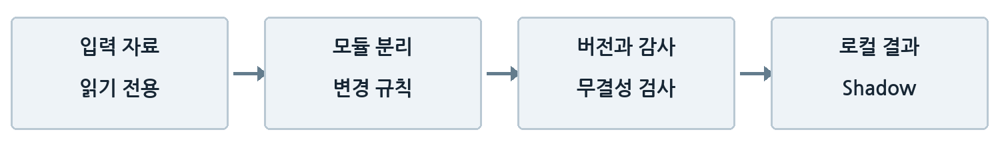
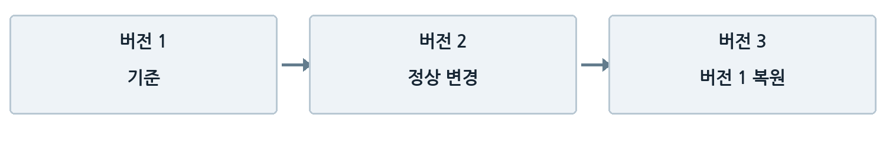

# ICT 안전 프로젝트 DMF 적용 보고서

곽윤석  |  2026년 11월 20일

CCTV 쓰레기 탐지 프로젝트의 개발 자료와 평가 결과를 문서 단위로 관리하고, 변경 제한과 버전 이력의 무결성을 확인한 적용 결과를 정리한다. 이번 14차는 탐지 모델을 학습하거나 성능을 높이는 작업이 아니다.

적용 결과는 로컬 검증을 위한 Shadow 산출물이다. 실제 사람의 승인과 공식 배포는 이 결과에 포함되지 않는다. 운영 트래픽 비교도 수행하지 않았다. 기존 5차의 객체 탐지 결과는 기준 자료로 보존하며, 마지막 학습 실험의 저장 기록과 구분한다.

| 구분 | 이번에 다룬 내용 | 판단 범위 |
| --- | --- | --- |
| 프로젝트 | CCTV 쓰레기 후보 탐지와 의심 장면 확인 | 객체 탐지와 행동 판정을 구분 |
| DMF 적용 | 자료 모듈, 변경 제한, 버전 및 감사 기록 | 로컬 문서 무결성 검증 |
| 산출물 | 보고서와 실행 결과 JSON | 공식 승인이나 배포는 보류 |

---

## 1 프로젝트와 적용 목적

이 프로젝트는 CCTV 영상에서 쓰레기 후보 객체를 탐지하고, 사람과 객체의 시간적 관계를 분석하여 투기 의심 장면을 확인하도록 돕기 위해 개발했다. 영상 선택과 탐지 설정, 결과 및 성능 확인, 실행 기록을 대시보드에서 살펴보는 구성을 갖는다.

기존 개발 내용을 수정할 때 평가 조건과 개인 정보 경계까지 함께 바뀌면 과거 결과를 잘못 해석하거나 공개 범위를 넘을 수 있다. 따라서 프로젝트 목적, 개발 내용, 측정 결과, 안전 경계를 각각 관리하고 변경 전후를 추적하는 데 DMF를 적용했다.

10차 화면은 현재 작업 제목과 실제 단계 상태를 나타내는 움직이는 3D 모형을 사용한다. 13차는 과거 데이터 파일 명의 ID를 보존된 코드와 주석에 맞추어 해석하는 복구기를 추가했으며, 원본 준비 코드와 실효 복구 코드의 해시 및 실행 계보를 보존했다. 재인코딩된 사진과 새 원본의 바이트가 같다는 주장은 하지 않는다.

| 자료 | 관리할 사실 | 유의점 |
| --- | --- | --- |
| 프로젝트 개요 | 목적과 대시보드 기능 | 성능 향상 주장과 분리 |
| 개발 내용 | 10차 화면과 13차 복구 | 기존 차수의 이력 보존 |
| 관측 사실 | 5차 테스트 및 마지막 저장 상태 | 새 실험 결과로 전용하지 않음 |
| 안전 경계 | 개인정보와 평가 조건 | 변경 제한과 공개 제외 |

---

## 2 적용 범위와 관리 방식

14차는 네 개의 자료를 입력으로 사용한다. 프로젝트의 목적과 개발 설명, 관측 사실, 안전 경계를 모듈로 표현하고 각 항목에 맞는 변경 규칙을 둔다. 원본은 읽기 전용으로 취급하며 검증 사례는 사본을 이용한다.

| 변경 구분 | 의미 | 적용 관점 |
| --- | --- | --- |
| 불변 | 변경해서는 안 되는 내용 | 개인정보 경계와 평가 원칙 보호 |
| 제한 | 허용 범위 안에서 변경 | 변경 시 위험도 R2 하한 |
| 가변 | 일반 개정 가능한 내용 | 개정 이력과 무결성을 추적 |

고정 테스트 결과를 보고 모델이나 임계값을 다시 선택하지 않는다. 선택과 조정은 검증 세트에서만 수행한다. CCTV 영상, 얼굴과 개인 식별 정보, 인증값 및 개인 지침은 공개 산출물에서 제외한다. 사용자 요청으로 일시정지한 학습도 문서 검증 과정에서 재개하지 않는다.

사용한 원본은 leecursion/DMF의 고정 커밋 cf550e3b2ceb0946ba89f64e43b7d6c2f5164383이다. 라이선스가 확인되지 않아 외부 원본 코드는 재배포하지 않는다. 이번 적용은 로컬 라이브러리를 활용하는 범위이며 운영 서버와 외부 승인 체계를 구축한 것은 아니다.

---

## 3 버전과 검증 절차

기준 자료를 버전 1로 만들고 허용되는 변경을 반영한 버전 2를 생성한다. 이후 버전 1의 내용을 되돌린 버전 3을 새 이력으로 남긴다. 되돌리기 자체도 별도 버전으로 기록하여 이전 변경을 지우지 않는다.

검증은 정상 변경과 불변 항목 위반 및 제한 항목 접촉을 함께 살펴본다.

제한 항목은 합성 사본의 추가 바이트가 원문의 100%를 넘는 사례에서 R2 위험도 하한을 반환했으며, API가 20% 변경률을 자동 계산하거나 집행한 것은 아니다.

병합 가능한 변경과 충돌하는 변경을 구분하고, 감사 기록과 파일을 변조한 사례를 시험한다.

각각의 결과는 실행 결과 폴더의 JSON에 남기며 상세 사유는 검증 결과.json의 항목별 detail에서 확인할 수 있다.

버전 기록.json은 버전과 부모 관계를, 감사 기록.json은 작업 이력을, 입력해 시.json은 입력 자료의 해시를 담는다.

모듈 내용.json은 내용해 시를 키로 원본 네 문서와 개정 문구를 보관한다.

재검증은 해당 바이트 해시와 버전 참조 및 입력 원문을 대조한다.

실행 봉인.json은 실행 산출물의 무결성 확인에 사용된다.

로컬 해시와 감사 기록은 신뢰된 전자 서명이나 외부 타임 스탬프가 아니며 사실 자체의 진실성을 증명하지 않는다.

---

## 4 로컬 실행 결과

실행 결과의 상태는 Shadow이며 범위는 local_validation_only이다. 검사 결과는 14개 중 14개 통과로 기록되었다. 공식 승격 상태는 pending_human_review이며 사람의 검토가 남아 있다.

| 검사 | 결과 | 상세 |
| --- | --- | --- |
| 가변 모듈 정상 수정 허용 | PASS | 실제 입력 사본의 예시 개정, R1 |
| 불변 안전 경계 변경 거부 | PASS | CORE_MODIFIED |
| 제한 모듈 대폭 변경의 R2 하한 | PASS | 합성 사본의 추가 바이트가 원문 100% 초과. API는 변경률 20%를 계산하지 않고 제한 등급 접촉만으로 R2를 반환한다. 비율 정책 자동 집행 아님. |
| 롤백은 직전 버전에 연결한 새 버전 | PASS | v3 부모=v2, 내용=v1, 기존 버전 보존 |
| 소급 버전 내용 변조 탐지 | PASS | 합성 사본 메타데이터 변조 |
| 저장 manifest 필드 변조 탐지 | PASS | wrapper에서 저장 값과 실제 재계산 값 추가 비교 |
| 저장 불변 봉인 필드 변조 탐지 | PASS | wrapper에서 저장 값과 실제 재계산 값 추가 비교 |
| 서로 다른 모듈의 병합 | PASS | 두 편집 결과 해시 보존 |
| 같은 모듈 충돌 탐지 | PASS | 자동 덮어쓰기 안 함 |
| 감사 행 변조 탐지 | PASS | 합성 사본 actor 변경 |
| 감사 꼬리 삭제 탐지 | PASS | 동일 로컬 head와 대조 |
| 빈 감사와 비영 앵커 거부 | PASS | wrapper 빈체인 검사, 외부 앵커 아님 |
| 원본 입력 바이트 보존 | PASS | 입력 4 파일 전후 SHA-256일 치 |
| 실제 임 포트된 고정 원본 확인 | PASS | 원본 20 파일 바이트/크기/Git blob 및 실제 임 포트 7 파일 SHA 검증 |

이 결과는 이 실행에서 기록한 검사사례의 결과이다. 결과 파일과 실행 코드를 함께 대조해야 하며 모든 가능한 공격이나 운영 환경까지 검증했다는 뜻은 아니다.

---

## 5 보존된 객체 탐지 결과

아래 수치는 5차에서 보존한 테스트 결과다. 테스트 이미지 150개에 대해 IoU 0.5와 신뢰도 임계 값 0.1의 동작 점에서 집계했다. 임계 값 선택은 검증 세트에서 이루어졌다. 백분율은 소수 첫째 자리에서 반올림하며 원 비율은 부록에 보존한다.

| 지표 | 표시 | 측정 조건 |
| --- | --- | --- |
| 정밀도 | 52.0% | TP / (TP + FP) |
| 재현율 | 53.7% | TP / (TP + FN) |
| mAP50 | 47.5% | 자체 평가 결과 |
| mAP50-95 | 32.4% | 자체 평가 결과 |
| 검출 집계 | TP 280 / FP 258 / FN 241 | IoU 0.5, 임계값 0.1 |

평가기는 신뢰도 순서와 IoU에 따른 탐욕적 매칭 및 101점 보간 AP를 사용한다. 자체 평가 결과를 COCO 공식 API 결과와 동등하다고 취급하지 않는다. 정밀도와 재현율 목표 90%는 달성되지 않았다.

객체 탐지의 검출 성능과 실제 투기 행동 판정의 정확도는 별개다. CCTV 투기 행동에 대한 정답 라벨이 없으므로 행동 정확도는 측정하지 않았다. 이 수치는 14차 DMF 적용으로 새로 얻은 성능이 아니다.

---

## 6 현재 상태와 남은 검토

마지막 실험의 저장 기록에는 diverse_coco26l 학습이 60 에포크 중 2 에포크로 표시되어 있다. 사용자는 일시정지를 요청했다. 기록된 running 값은 저장 당시 상태이며 이번 문서 작업에서는 현재 프로세스가 실행 중인지 조회하지 않았다. 최종 테스트 결과도 없다.

| 항목 | 현재 범위 | 남은 일 |
| --- | --- | --- |
| 로컬 Shadow | 문서 변경 및 무결성 사례 검증 | 사람이 결과와 적용 범위를 검토 |
| 공식 승인 | 승인 기록 없음 | 실제 승인 절차가 필요 |
| 운영 연동 | 서버·DB·OIDC·KMS 미구현 | 별도 설계 및 구현 필요 |
| 행동 판정 | 정답 라벨 부재 | 측정 가능한 라벨과 평가 필요 |
| 학습 | 사용자 일시정지 요청 | 재개 여부는 별도 결정 |

사용자가 별도 제출 양식을 지정하지 않아 보고서와 실행 검증 자료를 함께 구성했다. 이 문서는 구현 및 검증 근거를 설명하는 자료이며 교수의 승인, 안전 인증 또는 실제 배포 승인을 나타내지 않는다.

---

## 부록 원값과 참고 자료

| 항목 | 저장된 원값 | 구분 |
| --- | --- | --- |
| 정밀도 | 0.5204460966542751 | 5차 테스트 |
| 재현율 | 0.5374280230326296 | 5차 테스트 |
| F1 | 0.5288007554296507 | 5차 테스트 |
| mAP50 | 0.47478490228878745 | 5차 테스트 |
| mAP50-95 | 0.32448405525952334 | 5차 테스트 |

1. 14차 자료: 프로젝트 개요.md, 개발 내용.md, 관측 사실.json, 안전 경계.md. 원값과 제한은 관측 사실.json 및 안전 경계.md를 기준으로 하였다.

2. 14차 실행 결과: 버전 기록.json, 감사 기록.json, 입력해 시.json, 검증 결과.json, 모듈 내용.json, 실행 봉인.json. 각 파일은 실제 실행 결과와 확인 근거를 담는다.

3. leecursion/DMF, https://github.com/leecursion/DMF, 고정 커밋 cf550e3b2ceb0946ba89f64e43b7d6c2f5164383. 원본 라이선스 미확인으로 코드는 재배포하지 않는다.
