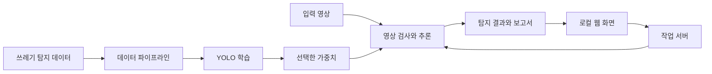

# 공개 차수와 비교

비교는 공개 저장소의 각 하위 폴더를 상대 경로로 맞춘 실제 바이트 기준이며 용도가 다른 자료 사이의 차이는 성능 변화를 뜻하지 않습니다. 데이터·실행 상태 등 민감 가능 자료는 원문을 비교 패치에 복제하지 않고 크기와 해시로 표시합니다. 6차는 5차 전체가 아닌 변경 전 일부 파일을 보존합니다. 7차 비교는 아래 문서에 적힌 기준 커밋 시점입니다.

| 공개 경로 | 자료 설명 | 바로 앞 자료와 공개 파일 비교 |
|---|---|---|
| [1차](1차/) | [단일 클래스 탐지 노트북](docs/versions/stage-1.md) | 이전 차수 근거 없음 |
| [2차](2차/) | [봉투·낱개와 영상 후보](docs/versions/stage-2.md) | [1차 → 2차](docs/comparisons/1-to-2.md) |
| [최종/3차](최종/3차/) | [학습·검증·영상 실행](docs/versions/stage-3.md) | [2차 → 3차](docs/comparisons/2-to-3.md) |
| [최종/4차](최종/4차/) | [프레임·문서 작업](docs/versions/stage-4.md) | [3차 → 4차](docs/comparisons/3-to-4.md) |
| [최종/최종](최종/최종/) | [3차 성능보고서](docs/versions/stage-5.md) | [4차 → 최종](docs/comparisons/4-to-final.md) |
| [5차](5차/) | [대시보드·추가 학습](docs/versions/round-5.md) | [최종/최종 → 5차](docs/comparisons/final-to-5.md) |
| [6차/변경전_5차](6차/변경전_5차/) | [5차의 변경 전 부분 보존본](docs/versions/round-6.md) | [5차의 대응 파일과 비교](docs/comparisons/5-to-6-snapshot.md) |
| [7차](7차/) | [대규모 자료 추가 학습 코드](docs/versions/round-7.md) | [5차 → 7차](docs/comparisons/5-to-7.md); 6차는 부분 보존본 |
| [8차](8차/) | [원래 클린뷰 복원·한국 시각·7차 상태 연결](docs/versions/round-8.md) | [7차 → 8차](docs/comparisons/7-to-8.md); 화면 원본5차와 비교도 포함 |
| [이전 도커 실험](이전%20도커%20실험/) | [이전 실험 보관](docs/versions/docker-experiment.md) | [최종/3차와 비교](docs/comparisons/docker-to-3.md); 시간 순서 근거 없음 |
| [최종](최종/) | [하위 자료 보관 폴더](docs/versions/final-container.md) | 상위 컨테이너로 별도 차수가 아닙니다 |

<div align="center">

# 🧹 Illegal Dumping Detection Project

물체의 정지 시간과 사람의 이탈을 분석해 불법투기 의심 이벤트를 찾습니다.

**기술 분류:** 컴퓨터 비전 › 객체 검출·추적 › 정지·주변 사람 조건의 이벤트 후보

`Python`
`YOLO`
`OpenCV`
`Docker`

[빠른 시작](#quick-start) · [저장소 구성](#repository-structure) · [데이터 구성](#data-settings)

[핵심 구성](#input-processing-output)

</div>

<a name="overview"></a>

## ✨ 주요 개발 내용

고정 테스트와 CCTV 해석 한계를 포함한 3차 최종 성능보고서를 보관합니다.

실험 보고서에 기록된 결과입니다.

- 저장 HTML은 고정 test 150장과 선택한 앙상블·정책의 결과를 보고합니다. 관련 CSV·그림은 보존 산출물입니다.
- 정밀도·재현율 목표 미달과 행위 정답 없는 CCTV의 정확도 미계산을 함께 확인해야 합니다.

**자료별 안내:** [최종](docs/versions/final-container.md) · [1차](docs/versions/stage-1.md) · [2차](docs/versions/stage-2.md) · [최종/3차](docs/versions/stage-3.md) · [최종/4차](docs/versions/stage-4.md) · [최종/최종](docs/versions/stage-5.md) · [전체 기록](docs/VERSIONS.md)

<a name="preview"></a>

<a name="input-processing-output"></a>

## 🔄 입력·처리·출력

| 단계 | 이 프로젝트에서 다루는 내용 |
| :--- | :--- |
| 📥 입력 | 쓰레기 라벨 영상·검사할 동영상 |
| ⚙️ 처리 | YOLO 검출과 IoU 연결, 정지 시간·사람 이탈 조건 |
| 📤 출력 | 검토 후보·결과 영상·CSV·보고서 |


---

<a name="introduction"></a>

## ✨ 프로젝트 소개

영상에서 쓰레기 후보를 찾고 사람이 살펴볼 장면을 정리하는 프로젝트입니다.

환경 영상에서 쓰레기 객체를 찾기 위한 데이터 준비·학습·추론 과정을 담았습니다. 초기 노트북과 후속 실험 코드를 보존하고, 클린뷰에서는 영상 업로드·미리보기·작업 상태·결과 확인 흐름을 구성합니다.

| 기능 | 구현 내용 |
| :--- | :--- |
| 🗂️ 데이터 준비 | 쓰레기 탐지 데이터 수집·변환·학습 입력 구성 |
| 🧠 모델 학습 | YOLO 기반 학습과 실험 결과 정리 |
| 🎞️ 영상 탐지 | 입력 영상의 프레임을 읽어 모델 추론 수행 |
| 🖥️ 로컬 화면 | 영상 업로드, 미리보기, 작업 시작·상태·로그 확인 |
| 🧵 작업 관리 | 작업별 상태 JSON과 로그, 동시 작업 시작 제한 |
| 📄 결과 정리 | 결과 저장과 보고서 생성 코드 |



<a name="repository-structure"></a>

## 📁 저장소 구성

실험 진입점과 주요 모듈은 다음과 같습니다.

```text
.
├── 1차/illegal_dumping_trash_all_new_datasets.ipynb
├── 2차/illegal_dumping_detector.ipynb
├── 이전 도커 실험/
├── 최종/
│   └── 3차/
│       ├── 데이터/taco/
│       └── 클린뷰/
│           ├── data_pipeline.py
│           ├── train_round3.py
│           ├── detector.py
│           ├── inference.py
│           ├── backend.py
│           ├── launcher.py
│           ├── make_report.py
│           └── requirements-docker.txt
├── docs/VERSIONS.md
└── CHANGELOG.md
```

- [2차 연구 노트북](2차/illegal_dumping_detector.ipynb): 불법투기 탐지 실험의 노트북 진입점.
- [데이터 준비](최종/3차/클린뷰/data_pipeline.py)와 [학습 코드](최종/3차/클린뷰/train_round3.py).
- [영상 프레임 처리·결과 저장](최종/3차/클린뷰/detector.py), [공통 예측·고정 이미지 평가](최종/3차/클린뷰/inference.py), [작업 서버](최종/3차/클린뷰/backend.py), [로컬 실행기](최종/3차/클린뷰/launcher.py).
- [의존성 명세](최종/3차/클린뷰/requirements-docker.txt)와 [버전 기록](docs/VERSIONS.md).

<a name="implementation"></a>

## 🧩 주요 기술과 실행 구조

영상은 Ultralytics로 객체를 찾고 OpenCV로 프레임을 처리합니다. 작업 서버는 Linux의 파일 잠금과 프로세스 상태를 사용하며, 로컬 실행기는 Docker 안의 작업 코드와 통신합니다.

`backend.py`의 `TRASH_BASE` 기본값은 `/root/환경 PBL`입니다. 하위 `trash_round3/app`에 상태·업로드·결과 경로를 구성합니다. 로컬 실행기에는 기존 `2026-2` 컨테이너를 전제로 한 처리가 있으므로, 다른 환경에서는 컨테이너 이름·마운트·원격 경로를 함께 확인해야 합니다.

작업 상태와 선택 모델은 파일로 관리합니다. 영상 확장자와 허용 폴더를 확인한 뒤 첫 프레임·FPS·파일 크기 등을 검사하므로, 파일 복사가 끝난 다음 추론을 시작하는 흐름입니다.

### 🧪 데이터 분리와 모델 선택

`data_pipeline.py`는 기존 사진 정체성과 라벨을 유지하고 검증·테스트 원본의 SHA-256을 대조합니다. TACO 추가 사진과 pLitterStreet 입력을 수집하며, 기존 URL과 pHash 거리 6 이하의 근접 중복을 제외합니다. 작은 물체 확대 이미지는 학습 사진에서만 만듭니다. 다운로드 코드의 존재와 실제 데이터의 재배포 권한은 구별해야 합니다.

| 단계 | 최종 3차 코드의 설정 |
| :--- | :--- |
| 후보 학습 | YOLO26x·YOLO26l-P2, mix 각 180 epoch → focus 각 60 epoch |
| 입력과 최적화 | 1536 픽셀, batch 2, AdamW, seed 20261013; GPU 메모리 부족 시 batch 1 재시도 |
| 고정 평가 | 검증 150장·테스트 150장; 평가 시 정확한 장수를 검사 |
| 추론 후보 | 전체 이미지, 전체+2×2 타일, 전체+3×3 타일; 중복 상자 NMS IoU 0.5 |
| 선택 기준 | 검증에서 min(정밀도, 재현율), F1, mAP50 순으로 선택 |
| 최종 테스트 | 선택한 모델·정책·신뢰도를 고정한 뒤 평가; 테스트 뒤 재학습 없음 |
| 목표 판정 | IoU 0.50에서 정밀도와 재현율 각각 0.90 이상인지 검사 |

이 표는 실험 설정과 판정 기준입니다. 이전 차수는 축소 입력을, 후속 평가는 원본 해상도를 사용합니다.

### 🎬 영상에서 의심 장면을 만드는 조건

`detector.Events`는 쓰레기 상자를 IoU 0.25 초과로 연결하고, 정지 기준 상자와 IoU가 0.55 미만이면 정지 시간을 다시 셉니다. 기본값은 초기 10초 동안 지속 관측한 기존 물체 제외, 새 물체 정지 20초, 주변 사람 이탈 5초입니다. 최소 3회 관측과 한 번만 알림 조건도 적용합니다. 사람 발 위치와 물체 중심의 화면상 거리를 사용하므로 사람의 소유 관계나 투기 행위 자체를 인식한 결과는 아닙니다.

ROI는 0~1 좌표의 다각형으로 받고, 결과는 `result.mp4`, 프레임별 `frames.csv`, 이벤트·설정의 `summary.json`으로 나뉩니다. `frames.csv`의 `new_candidates`는 해당 프레임에서 새로 생긴 수가 아니라 그 시점까지 누적된 이벤트 수입니다. 영상 중간 디코딩 실패는 완료로 처리하지 않습니다.

### ⚙️ 실행기와 보조 파일

`launcher.py`는 127.0.0.1에만 바인딩하고 매 실행 난수 토큰을 사용합니다. Docker의 기존 `2026-2` 컨테이너로 작업 코드를 복사하며, 영상 업로드는 4GB 이하로 제한합니다. `--self-test`도 컨테이너 초기화와 파일 복사를 수행하므로 단순한 읽기 전용 검사는 아닙니다.

`data_pipeline.py`의 루트는 `/root/환경 PBL/trash_round3`로 고정되어 있습니다. `backend.py`의 `TRASH_BASE` 하나만 바꾸어 전체 프로젝트 경로가 이동하지는 않습니다. `fonts/NanumGothic-Bold.ttf`, 고정 분할 manifest, 데이터·가중치와 선택 모델 파일을 함께 준비해야 합니다.

`build_windows.ps1`은 PyInstaller로 화면·작업 코드·폰트를 묶는 도구입니다. `make_report.py`는 저장된 최종 평가로 그래프·CSV·HTML을 만듭니다. `finalize_round3.py`와 `finish_on_exit.py`는 특정 과거 작업 ID·폴더에 연결된 결과 보관 도구이므로 새 학습을 시작하는 일반 명령으로 사용하지 않습니다.

### 📚 초기 실험과 외부 TACO 코드

1차 노트북은 YOLOv8m을 150 epoch·입력 960·batch 16으로 설정하고, TACO와 Amsterdam 자료를 출처별 무작위 80/10/10으로 나눕니다. 이 분할은 후속 코드의 중복 그룹 관리와 같지 않습니다. 초기 영상 결과에는 투기 행위 정답 라벨이 없으므로 정지·추적 조건을 만족한 장면은 검토 후보로 해석합니다. 초기 재개 JSON도 모델·영상·설정 해시에 결합되어 있지 않습니다.

`데이터/taco/`의 외부 코드는 Pedro F. Proença와 Matterport 계열의 MIT 라이선스 Mask R-CNN 구현입니다. TensorFlow 1·Keras 2 기반이며 클린뷰의 PyTorch·YOLO 학습 코드와 개발 귀속·성능을 구분합니다. `detector.py`는 train/test/evaluate(COCO segmentation) 명령을 제공하고, 세 노트북은 통계·전처리·anchor/ROI 탐색을 다룹니다.

TACO의 `requirements.txt`만으로 TensorFlow·Keras·imgaug·scikit-image·SciPy·pycocotools·h5py가 모두 충족되지는 않습니다. 코드의 최소 버전 검사는 TensorFlow 2·Keras 3 호환성 보증이 아닙니다. 공개 사본에는 클래스 매핑 CSV와 원본 이미지·주석·가중치가 없으므로 해당 외부 예제를 바로 실행할 수 없습니다. 기존 README와 LICENSE를 함께 확인하세요.

<a name="quick-start"></a>

## 🚀 빠른 시작

### 📓 노트북부터 살펴보기

저장소 루트에서 노트북을 엽니다. 셀을 실행하기 전 데이터 경로와 다운로드 설정을 확인합니다.

```powershell
python -m pip install jupyterlab
python -m jupyter lab "2차/illegal_dumping_detector.ipynb"
```

### 🖥️ 클린뷰 실행 환경 준비

1. Docker 컨테이너와 GPU 환경을 준비하고, `launcher.py`의 컨테이너·원격 경로를 확인합니다.
2. 데이터와 모델 가중치를 준비하고, 컨테이너의 `TRASH_BASE` 및 `trash_round3` 디렉터리 구조를 맞춥니다.
3. 컨테이너 안의 Python 환경에 [의존성 명세](최종/3차/클린뷰/requirements-docker.txt)의 패키지를 준비합니다. 기존 CUDA PyTorch를 재사용하도록 작성된 명세이므로 CPU 패키지로 임의 교체하지 않습니다.
4. 필요한 화면 자산과 모델 선택 파일이 준비되어 있는지 확인한 뒤 로컬 실행기를 시작합니다.

```powershell
cd "최종/3차/클린뷰"
python launcher.py --no-browser
```

실행기는 로컬 주소와 접근 토큰을 세션 파일에 기록합니다. 위 명령은 코드에 존재하는 실행 진입점이며, 이 공개 사본만으로 Docker·데이터·모델까지 자동 설치되지는 않습니다. 원본 영상과 학습 가중치는 별도로 준비해야 합니다.

<a name="data-settings"></a>

## 📊 데이터 구성과 실험 설정

### 📊 보존한 최종 성능 보고서

[3차 최종 보고서](최종/최종/성능보고서/3차_최종보고서.html)와 [최종 성능 CSV](최종/최종/성능보고서/최종성능.csv)를 함께 보관합니다. 다음 수치는 저장된 CSV의 **고정 테스트 150장·검증에서 선택한 신뢰도** 조건을 반올림한 값입니다.

| 지표 | 보존된 결과 |
| :--- | ---: |
| 정밀도 | 61.36% |
| 재현율 | 65.83% |
| F1 | 63.52% |
| mAP50 | 67.31% |
| mAP50–95 | 45.70% |

정밀도·재현율 각각 90% 이상이라는 목표에는 미달했습니다.  보고서의 그래프 5개·집계 CSV와 기존 글꼴·OFL 라이선스를 함께 포함합니다. GitHub에서 HTML은 소스로 표시될 수 있으므로 보고서 폴더를 함께 내려받아 로컬 브라우저로 확인할 수 있습니다.


| 구성 | 역할 |
| :--- | :--- |
| TACO 관련 코드 | 쓰레기 데이터 다운로드와 탐지 데이터 처리 참고 |
| 노트북 입력 데이터 | 각 실험 셀에서 지정한 탐지 데이터셋 |
| 모델 가중치 | 학습 결과 또는 사용자가 준비한 탐지 모델 |
| 영상 입력 | `.mp4`, `.avi`, `.mov`, `.mkv`, `.m4v` |
| 작업 상태 | 작업별 JSON, 실행 로그, 선택 모델 정보 |
| 결과 | 탐지 결과 영상·파일과 보고서 생성물 |

데이터셋의 다운로드 경로와 이용 조건은 각각 확인해야 합니다. 코드에 포함된 다운로드 도구가 해당 데이터 전체를 저장소에서 배포한다는 뜻은 아닙니다.

객체 탐지와 추적으로 사람이 검토할 쓰레기 후보 장면을 찾습니다. 행동 의도와 법적 위반 여부의 판단에는 별도의 확인이 필요합니다. 성능 비교에는 같은 데이터 분할·모델·추론 조건을 사용합니다.

<a name="troubleshooting"></a>

## 🛠️ 문제 해결

| 증상 | 확인할 내용 |
| :--- | :--- |
| Docker 또는 컨테이너 오류 | Docker 실행 여부, `launcher.py`의 컨테이너 이름과 경로 |
| 모델을 찾지 못함 | 가중치 파일 위치와 선택 모델 정보 |
| 영상 미리보기가 실패함 | 복사 완료 여부, 0바이트 파일, 코덱, 첫 프레임·FPS |
| 새 작업이 시작되지 않음 | 진행 중인 작업과 작업별 상태·로그 |
| Linux 파일 잠금 오류 | `backend.py`를 Linux 컨테이너 환경에서 실행했는지 확인 |
| 로컬 화면 접근 오류 | 실행기가 생성한 현재 세션 URL과 접근 토큰 |

---

<div align="center">

**데이터 준비 → 학습 → 영상 탐지 → 결과 확인**

</div>

## 2026-10-30 실행·추가 학습 자료

[D 드라이브 대시보드와 5차 코드](5차/README.md)에 실행 조건과 학습 후 오류 진단을 정리했습니다. 최종 성능 평가는 별도로 확인해야 합니다.

## 7차 대규모 자료 추가 학습

[7차 코드와 실행 조건](7차/README.md)에 원본 보존·출처 균형·분할 평가·독립 작업을 정리했습니다. 2026-10-30 자료 수신 및 자동 준비 작업을 시작했으며, 장기 학습 완료와 90% 달성은 아직 확인되지 않았습니다.
