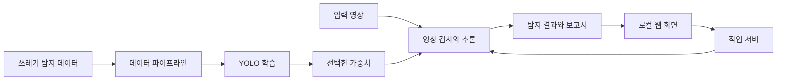

# Illegal Dumping Detection Project · LEVEL 1 - Beginner

[LEVEL 1 - Beginner](%EB%A0%88%EB%B2%A81.md) · [LEVEL 2 - Explorer](%EB%A0%88%EB%B2%A82.md) · [LEVEL 3 - Practitioner](%EB%A0%88%EB%B2%A83.md) · [LEVEL 4 - Advanced](%EB%A0%88%EB%B2%A84.md) · [LEVEL 5 - Expert](%EB%A0%88%EB%B2%A85.md)

[같은 수준의 프로필](https://github.com/PUVKID/PUVKID/blob/main/docs/읽기안내/레벨1.md) · [프로젝트 첫 화면](../../README.md)

## LEVEL 1 · 프로젝트 소개와 읽는 방법

영상에서 쓰레기와 사람을 찾고 물체의 정지·사람 이탈 같은 조건으로 사람이 확인할 장면을 고르는 프로젝트입니다. **의심 장면은 불법행위 확정이 아닙니다.** 자료 준비·학습·영상 화면·복구·보고서가 여러 차수에 나뉘어 있습니다.

## LEVEL 1 · 실제 기능과 동작 범위

| 확인할 항목 (Checklist) | 본문의 핵심 조건 |
| --- | --- |
| 기능·동작 | 노트북은 자료를 준비하고 모델을 배우게 하는 순서를 담습니다. 클린뷰는 영상을 처리하고 화면을 제공하며 후속 화면은 현재 작업·대기·오류를 보여 줍니다. 복구와 보고서 도구는 새 성능을 만드는 단계가 아닙니다. |
| 입력·처리·출력 | 입력은 쓰레기 영상·정답 표시와 처리할 동영상입니다. 모델이 물체 후보를 찾고 시간·사람 조건을 더해 검토 장면을 만듭니다. 출력 영상과 보고서를 사람이 읽어야 합니다. |
| 결과·한계 | 보존한3차 보고서는 목표에 미달했습니다. 객체를 찾은 정밀도·재현율과 CCTV에서 투기 행동을 맞혔는지는 다른 평가이며 행동 정답이 없으면 정확도를 계산했다고 쓰지 않습니다. |


노트북은 자료를 준비하고 모델을 배우게 하는 순서를 담습니다. 클린뷰는 영상을 처리하고 화면을 제공하며 후속 화면은 현재 작업·대기·오류를 보여 줍니다. 복구와 보고서 도구는 새 성능을 만드는 단계가 아닙니다.

사용자가 보는 동작을 먼저 설명하고 아래 실제 기능표의 이름과 연결합니다.

**기능별 공통 근거**

영상에서 쓰레기 후보를 찾고 사람이 살펴볼 장면을 정리하는 프로젝트입니다.

환경 영상에서 쓰레기 객체를 찾기 위한 데이터 준비·학습·추론 과정을 담았습니다. 초기 노트북과 후속 실험 코드를 보존하고, 클린뷰에서는 영상 업로드·미리보기·작업 상태·결과 확인 흐름을 구성합니다.

| 기능 | 구현 내용 |
| --- | --- |
| 데이터 준비 | 쓰레기 탐지 데이터 수집·변환·학습 입력 구성 |
| 모델 학습 | YOLO 기반 학습과 실험 결과 정리 |
| 영상 탐지 | 입력 영상의 프레임을 읽어 모델 추론 수행 |
| 로컬 화면 | 영상 업로드, 미리보기, 작업 시작·상태·로그 확인 |
| 작업 관리 | 작업별 상태 JSON과 로그, 동시 작업 시작 제한 |
| 결과 정리 | 결과 저장과 보고서 생성 코드 |



## LEVEL 1 · 입력에서 처리와 출력까지

입력은 쓰레기 영상·정답 표시와 처리할 동영상입니다. 모델이 물체 후보를 찾고 시간·사람 조건을 더해 검토 장면을 만듭니다. 출력 영상과 보고서를 사람이 읽어야 합니다.

| 단계 | 이 프로젝트에서 다루는 내용 |
| --- | --- |
| 입력 | 쓰레기 라벨 영상·검사할 동영상 |
| 처리 | YOLO 검출과 IoU 연결, 정지 시간·사람 이탈 조건 |
| 출력 | 검토 후보·결과 영상·CSV·보고서 |


---

## LEVEL 1 · 사용·실험 순서와 확인 방법

먼저 노트북 또는 클린뷰 등 보고 싶은 자료를 고릅니다. 각 안내의 데이터·모델·Docker 준비 조건을 읽고 실행한 뒤 결과와 오류를 확인합니다. 숫자가 없는 최종 미측정 상태를 임의로 채우지 않습니다.

## LEVEL 1 · 결과와 한계를 해석하는 기준

보존한3차 보고서는 목표에 미달했습니다. 객체를 찾은 정밀도·재현율과 CCTV에서 투기 행동을 맞혔는지는 다른 평가이며 행동 정답이 없으면 정확도를 계산했다고 쓰지 않습니다.

## LEVEL 1 · 구현과 핵심 파일을 연결해 읽기

초기 파일은 노트북, 후속은 자료·학습·추론·서버·화면 파일로 나뉩니다. 기능을 고른 다음 해당 차수의 코드·사용 안내·문제 해결로 이동합니다.

## LEVEL 1 · 용어와 실수하기 쉬운 구분

객체 탐지는 영상에서 사람·쓰레기 같은 물체의 위치와 종류를 찾는 일입니다. 추적은 여러 화면에서 같은 물체를 이어 보는 일입니다. 의심 이벤트는 사람이 검토할 후보 장면이며 법적 위반 확정이 아닙니다. 정밀도·재현율은 탐지 결과와 정답을 비교하는 서로 다른 지표이고 mAP는 위치·분류를 종합하는 탐지 평가값입니다. 검증 자료는 선택에, 고정 테스트는 최종 확인에 쓰며 출처·분할을 함께 읽습니다.

**객체 탐지 수치는 CCTV 투기 행동 판정 정확도가 아닙니다.** 정밀도·재현율 각90% 목표와 실제 결과를 구분합니다. 화면·수신 복구·보고서 도구의 실행이 학습 완료를 뜻하지 않으며 Docker·데이터·가중치와 원래 동결 환경을 별도로 준비해야 합니다.

## LEVEL 1 · 전체 차수와 같은 수준의 상세 설명

차수 이름은 실제 보관 단위를 따릅니다. 부분본·시험 도구·최종 안내는 제품 버전과 구분하며, 폴더와 직전 비교를 함께 연결합니다.

| 차수·자료 | 자료 |
| --- | --- |
| 1차 | **자료 폴더** [자료](../../1%EC%B0%A8)<br>**이 수준의 차수 설명** [LEVEL 1 - Beginner](../versions/stage-1.md#reading-level-1)<br>**직전 비교·범위** [전체 비교](../comparisons/initial.md) |
| 2차 | **자료 폴더** [자료](../../2%EC%B0%A8)<br>**이 수준의 차수 설명** [LEVEL 1 - Beginner](../versions/stage-2.md#reading-level-1)<br>**직전 비교·범위** [전체 비교](../comparisons/1-to-2.md) |
| 최종/3차 | **자료 폴더** [자료](../../%EC%B5%9C%EC%A2%85/3%EC%B0%A8)<br>**이 수준의 차수 설명** [LEVEL 1 - Beginner](../versions/stage-3.md#reading-level-1)<br>**직전 비교·범위** [전체 비교](../comparisons/2-to-3.md) |
| 최종/4차 | **자료 폴더** [자료](../../%EC%B5%9C%EC%A2%85/4%EC%B0%A8)<br>**이 수준의 차수 설명** [LEVEL 1 - Beginner](../versions/stage-4.md#reading-level-1)<br>**직전 비교·범위** [전체 비교](../comparisons/3-to-4.md) |
| 최종/최종 | **자료 폴더** [자료](../../%EC%B5%9C%EC%A2%85/%EC%B5%9C%EC%A2%85)<br>**이 수준의 차수 설명** [LEVEL 1 - Beginner](../versions/stage-5.md#reading-level-1)<br>**직전 비교·범위** [전체 비교](../comparisons/4-to-final.md) |
| 5차 | **자료 폴더** [자료](../../5%EC%B0%A8)<br>**이 수준의 차수 설명** [LEVEL 1 - Beginner](../versions/round-5.md#reading-level-1)<br>**직전 비교·범위** [전체 비교](../comparisons/final-to-5.md) |
| 6차 | **자료 폴더** [자료](../../6%EC%B0%A8/%EB%B3%80%EA%B2%BD%EC%A0%84_5%EC%B0%A8)<br>**이 수준의 차수 설명** [LEVEL 1 - Beginner](../versions/round-6.md#reading-level-1)<br>**직전 비교·범위** [전체 비교](../comparisons/5-to-6-snapshot.md) |
| 7차 | **자료 폴더** [자료](../../7%EC%B0%A8)<br>**이 수준의 차수 설명** [LEVEL 1 - Beginner](../versions/round-7.md#reading-level-1)<br>**직전 비교·범위** [전체 비교](../comparisons/5-to-7.md) |
| 8차 | **자료 폴더** [자료](../../8%EC%B0%A8)<br>**이 수준의 차수 설명** [LEVEL 1 - Beginner](../versions/round-8.md#reading-level-1)<br>**직전 비교·범위** [전체 비교](../comparisons/7-to-8.md) |
| 9차 | **자료 폴더** [자료](../../9%EC%B0%A8)<br>**이 수준의 차수 설명** [LEVEL 1 - Beginner](../versions/round-9.md#reading-level-1)<br>**직전 비교·범위** [전체 비교](../comparisons/8-to-9.md) |
| 10차 | **자료 폴더** [자료](../../10%EC%B0%A8)<br>**이 수준의 차수 설명** [LEVEL 1 - Beginner](../versions/round-10.md#reading-level-1)<br>**직전 비교·범위** [전체 비교](../comparisons/9-to-10.md) |
| 11차 | **자료 폴더** [자료](../../11%EC%B0%A8)<br>**이 수준의 차수 설명** [LEVEL 1 - Beginner](../versions/round-11.md#reading-level-1)<br>**직전 비교·범위** [전체 비교](../comparisons/10-to-11.md) |
| 이전 도커 실험 | **자료 폴더** [자료](../../%EC%9D%B4%EC%A0%84%20%EB%8F%84%EC%BB%A4%20%EC%8B%A4%ED%97%98)<br>**이 수준의 차수 설명** [LEVEL 1 - Beginner](../versions/docker-experiment.md#reading-level-1)<br>**직전 비교·범위** [전체 비교](../comparisons/docker-to-3.md) |
| 최종 | **자료 폴더** [자료](../../%EC%B5%9C%EC%A2%85)<br>**이 수준의 차수 설명** [LEVEL 1 - Beginner](../versions/final-container.md#reading-level-1)<br>**직전 비교·범위** [전체 비교](../comparisons/final-container.md) |
| 12차 | **자료 폴더** [자료](../../12%EC%B0%A8)<br>**이 수준의 차수 설명** [LEVEL 1 - Beginner](../versions/round-12.md#reading-level-1)<br>**직전 비교·범위** [전체 비교](../comparisons/11-to-12.md) |

## LEVEL 1 · 논문·원고와 원본 자료의 범위

원고·보고서·PDF가 있는 경로는 아래 원래 전체 안내의 실제 링크로 연결합니다. 12차는 완료 실험의 Word와 같은 원고 PDF를 만드는 후처리 도구이며 공개 고정 템플릿은 실제 최종 보고서가 아닙니다. 기존 최종 HTML·CSV·그래프는 보존 결과로 구분합니다.

## LEVEL 1 · 원래 모든 세부 설명으로 이동하기

설정값·코드 예제·실패 조건·측정 범위·화면과 파일별 안내를 생략하지 않도록 첫 화면의 전체 본문을 아래에 함께 둡니다. 각 항목은 이 페이지의 공통 근거로 바로 이동합니다. 원문에 담긴 이전 차수 조건을 현재 실행 조건으로 자동 적용하지 않습니다.

| 첫 화면의 원래 항목 | 이 페이지의 전체 근거 |
| --- | --- |
| Illegal Dumping Detection Project | [원문 보기](#source-section-1) |
| 데이터·학습·화면·복구·보고서를 나눈 구성 | [원문 보기](#source-section-2) |
| 차수별 개발 흐름 | [원문 보기](#source-section-3) |
| 공개 차수와 비교 | [원문 보기](#source-section-4) |
| 현재 실험을 보여 주는 10차 대시보드 | [원문 보기](#source-section-5) |
| 제가 구현한 부분 | [원문 보기](#source-section-6) |
| 주요 개발 내용 | [원문 보기](#source-section-7) |
| 입력·처리·출력 | [원문 보기](#source-section-8) |
| 프로젝트 소개 | [원문 보기](#source-section-9) |
| 저장소 구성 | [원문 보기](#source-section-10) |
| 주요 기술과 실행 구조 | [원문 보기](#source-section-11) |
| 데이터 분리와 모델 선택 | [원문 보기](#source-section-12) |
| 영상에서 의심 장면을 만드는 조건 | [원문 보기](#source-section-13) |
| 실행기와 보조 파일 | [원문 보기](#source-section-14) |
| 초기 실험과 외부 TACO 코드 | [원문 보기](#source-section-15) |
| 빠른 시작 | [원문 보기](#source-section-16) |
| 노트북부터 살펴보기 | [원문 보기](#source-section-17) |
| 클린뷰 실행 환경 준비 | [원문 보기](#source-section-18) |
| 데이터 구성과 실험 설정 | [원문 보기](#source-section-19) |
| 보존한 최종 성능 보고서 | [원문 보기](#source-section-20) |
| 문제 해결 | [원문 보기](#source-section-21) |
| 2026-10-30 실행·추가 학습 자료 | [원문 보기](#source-section-22) |
| 7차 대규모 자료 추가 학습 | [원문 보기](#source-section-23) |
| 11차 수신 복구 | [원문 보기](#source-section-24) |
| 12차 실험 보고서 도구 | [원문 보기](#source-section-25) |
| 최종 배포 사용안내 | [원문 보기](#source-section-26) |

## LEVEL 1 · 항목별 자세한 풀이와 확인 지점

### LEVEL 1 · 데이터·학습·화면·복구·보고서를 나눈 구성

이 항목은 다음 실제 조건으로 동작합니다. 용어는 앞선 설명과 연결하고 값·입력·출력이 무엇을 가리키는지 함께 읽습니다.

초기1·2차는 데이터 준비와 탐지 실험 노트북입니다.

최종/3차는 `data_pipeline.py`·`train_round3.py`·`inference.py`로 데이터·학습·추론을 나누고 `backend.py`·`launcher.py`와 화면을 연결합니다. 최종/4차는 기존 앙상블의 단일 프레임 확인 도구, 최종/최종은 HTML·CSV 성능보고서입니다. 자료 종류가 달라 동일한 학습 실행 절차를 적용하지 않습니다.

7차의 `prepare_dataset.py`·`train_pipeline.py`·`worker.py`는 출처·준비·후보 학습을 연결합니다. training.json의 seed는 20261030이며 후보당 6시간, GPU 여유 18,000MiB·대기 7,200초, 체크포인트 여유 8GiB를 설정합니다. diverse_coco26l 후보는 이미지960·batch4·60epoch·patience12·lr0=0.0005, small_l_p2는1280·batch2·45epoch·patience12·lr0=0.0001을 구성합니다. 값은 계획이며 실제 완료 에폭과 다릅니다.

검증 선택은 TACO의 min(precision,recall)·F1과 PlastOPol의 min(precision,recall)·AP50 순서를 사용하고 동률에는 기준 모델을 유지합니다. full/full_grid3 정책을 검토하며 평가 이미지1280·conf floor0.001·NMS IoU0.5·최대1000개 탐지를 설정합니다. 다운로드·최소 여유 공간은 각각100GiB입니다. 기존 평가와 독립 외부 평가의 출처·분할을 함께 읽어야 합니다.

8·10차 화면은 7차 작업 상태를 읽어 현재 단계·대기·오류·재시도를 표시합니다. 9차는 상태 파일 교체 권한 오류 뒤 수신을 재개한 기록이고, 11차는 원래 7차의 동결 파일 16개를 확인하는 복구 도구입니다. 12차는 실험 종료와 결과·가중치 해시를 확인하고 report_core·report_outputs·watcher로 Word/PDF를 만드는 후처리 구성입니다. 화면이나 복구 도구 실행이 학습 완료를 뜻하지 않습니다.

3차 최종 보고서의 고정 테스트150장·conf0.17·IoU0.50·ensemble/full 조건에서는 정밀도61.36%·재현율65.83%·F1 63.52%·mAP50 67.31%·mAP50–95 45.70%를 기록했습니다.

목표90%와 구분하며, 객체 탐지 수치는 CCTV 투기 행동 판정 정확도가 아닙니다. 단일 프레임 그림 역시 행동 판정이나 시험 지표 재계산 결과가 아닙니다.

노트북·실험 코드·영상 화면·복구·보고서는 서로 다른 일을 맡습니다. 선택한 자료의 입력·모델·실행 조건과 상태·결과를 확인합니다.

**오해하지 않을 점:** 계획값·실제 완료·평가 지표와 화면 성공을 분리합니다.

[이 항목의 전체 조건·원문](#source-section-2)

### LEVEL 1 · 차수별 개발 흐름

1차부터12차와 최종의 실제 보관 단위를 살펴보는 목차입니다. 같은 수준 상세·폴더·전체 비교를 함께 읽습니다.

**오해하지 않을 점:** 자료 단위·제품 버전·학습 실행 횟수를 같은 것으로 읽지 않습니다.

[이 항목의 전체 조건·원문](#source-section-3)

### LEVEL 1 · 공개 차수와 비교

이 항목은 다음 실제 조건으로 동작합니다. 용어는 앞선 설명과 연결하고 값·입력·출력이 무엇을 가리키는지 함께 읽습니다.

비교는 공개 저장소의 각 하위 폴더를 상대 경로로 맞춘 실제 바이트 기준이며 용도가 다른 자료 사이의 차이는 성능 변화를 뜻하지 않습니다. 데이터·실행 상태 등 민감 가능 자료는 원문을 비교 패치에 복제하지 않고 크기와 해시로 표시합니다. 6차는 5차 전체가 아닌 변경 전 일부 파일을 보존합니다. 7차 비교는 아래 문서에 적힌 기준 커밋 시점입니다.

1차 · [자료 폴더](../../1%EC%B0%A8) · [상세 설명](../versions/stage-1.md#reading-level-1) · [전체 비교·범위](../comparisons/initial.md)

2차 · [자료 폴더](../../2%EC%B0%A8) · [상세 설명](../versions/stage-2.md#reading-level-1) · [전체 비교·범위](../comparisons/1-to-2.md)

최종/3차 · [자료 폴더](../../%EC%B5%9C%EC%A2%85/3%EC%B0%A8) · [상세 설명](../versions/stage-3.md#reading-level-1) · [전체 비교·범위](../comparisons/2-to-3.md)

최종/4차 · [자료 폴더](../../%EC%B5%9C%EC%A2%85/4%EC%B0%A8) · [상세 설명](../versions/stage-4.md#reading-level-1) · [전체 비교·범위](../comparisons/3-to-4.md)

최종/최종 · [자료 폴더](../../%EC%B5%9C%EC%A2%85/%EC%B5%9C%EC%A2%85) · [상세 설명](../versions/stage-5.md#reading-level-1) · [전체 비교·범위](../comparisons/4-to-final.md)

5차 · [자료 폴더](../../5%EC%B0%A8) · [상세 설명](../versions/round-5.md#reading-level-1) · [전체 비교·범위](../comparisons/final-to-5.md)

6차 · [자료 폴더](../../6%EC%B0%A8/%EB%B3%80%EA%B2%BD%EC%A0%84_5%EC%B0%A8) · [상세 설명](../versions/round-6.md#reading-level-1) · [전체 비교·범위](../comparisons/5-to-6-snapshot.md)

7차 · [자료 폴더](../../7%EC%B0%A8) · [상세 설명](../versions/round-7.md#reading-level-1) · [전체 비교·범위](../comparisons/5-to-7.md)

8차 · [자료 폴더](../../8%EC%B0%A8) · [상세 설명](../versions/round-8.md#reading-level-1) · [전체 비교·범위](../comparisons/7-to-8.md)

9차 · [자료 폴더](../../9%EC%B0%A8) · [상세 설명](../versions/round-9.md#reading-level-1) · [전체 비교·범위](../comparisons/8-to-9.md)

10차 · [자료 폴더](../../10%EC%B0%A8) · [상세 설명](../versions/round-10.md#reading-level-1) · [전체 비교·범위](../comparisons/9-to-10.md)

11차 · [자료 폴더](../../11%EC%B0%A8) · [상세 설명](../versions/round-11.md#reading-level-1) · [전체 비교·범위](../comparisons/10-to-11.md)

이전 도커 실험 · [자료 폴더](../../%EC%9D%B4%EC%A0%84%20%EB%8F%84%EC%BB%A4%20%EC%8B%A4%ED%97%98) · [상세 설명](../versions/docker-experiment.md#reading-level-1) · [전체 비교·범위](../comparisons/docker-to-3.md)

최종 · [자료 폴더](../../%EC%B5%9C%EC%A2%85) · [상세 설명](../versions/final-container.md#reading-level-1) · [전체 비교·범위](../comparisons/final-container.md)

12차 · [자료 폴더](../../12%EC%B0%A8) · [상세 설명](../versions/round-12.md#reading-level-1) · [전체 비교·범위](../comparisons/11-to-12.md)

폴더 사이의 실제 파일 변화를 연결한 표입니다. 부분본·용도 차이와 기준 커밋을 확인합니다.

**오해하지 않을 점:** 파일 추가·삭제를 성능 변화로 환산하지 않고 민감 원문 대신 크기·해시인 범위를 보존합니다.

[이 항목의 전체 조건·원문](#source-section-4)

### LEVEL 1 · 현재 실험을 보여 주는 10차 대시보드

이 항목은 다음 실제 조건으로 동작합니다. 용어는 앞선 설명과 연결하고 값·입력·출력이 무엇을 가리키는지 함께 읽습니다.

다운로드·데이터 준비·GPU 학습·검증·최종 평가의 실제 상태를 입체 모형과 단계별 움직임으로 보여 줍니다. 영상 탐지·성능 분석·작업 기록은 같은 화면에서 확인합니다. 현재 파일의 진행률과 전체 실험 진행, 관측한 값과 최종 미측정을 구분합니다.

이 화면 변경은 학습 완료나 정밀도·재현율 각각 90% 달성을 뜻하지 않습니다. 시안의 예시 날짜와 수치는 실제 실험값으로 사용하지 않습니다.

실제 작업의 현재·다음 단계와 대기·오류·재시도를 입체 화면으로 보여 줍니다. 현재 파일 진행과 전체 실험·관측값과 최종 미측정을 나누어 확인합니다.

**오해하지 않을 점:** 시안의 예시 숫자·날짜와 실제 실험값,화면 변경과 학습 완료를 구분합니다.

[이 항목의 전체 조건·원문](#source-section-5)

### LEVEL 1 · 제가 구현한 부분

이 항목은 다음 실제 조건으로 동작합니다. 용어는 앞선 설명과 연결하고 값·입력·출력이 무엇을 가리키는지 함께 읽습니다.

쓰레기 객체 탐지 데이터 준비와 학습·평가, 영상 추론 및 실험 결과 정리 코드를 작성했습니다. 차수별 코드와 지표를 연결해 제가 구현한 내용을 확인할 수 있도록 정리합니다.

데이터 준비·학습·평가·영상 추론과 결과 정리의 구현 범위입니다. 실제 코드와 지표·문서의 담당 범위를 대조합니다.

**오해하지 않을 점:** 탐지 모델 개발을 법적 행위 판정·전체 환경 검증으로 확장하지 않습니다.

[이 항목의 전체 조건·원문](#source-section-6)

### LEVEL 1 · 주요 개발 내용

이 항목은 다음 실제 조건으로 동작합니다. 용어는 앞선 설명과 연결하고 값·입력·출력이 무엇을 가리키는지 함께 읽습니다.

고정 테스트와 CCTV 해석 한계를 포함한 3차 최종 성능보고서를 보관합니다.

실험 보고서에 기록된 결과입니다.

저장 HTML은 고정 test 150장과 선택한 앙상블·정책의 결과를 보고합니다. 관련 CSV·그림은 보존 산출물입니다.

정밀도·재현율 목표 미달과 행위 정답 없는 CCTV의 정확도 미계산을 함께 확인해야 합니다.

**자료별 안내:** [최종](../versions/final-container.md#reading-level-1) · [1차](../versions/stage-1.md#reading-level-1) · [2차](../versions/stage-2.md#reading-level-1) · [최종/3차](../versions/stage-3.md#reading-level-1) · [최종/4차](../versions/stage-4.md#reading-level-1) · [최종/최종](../versions/stage-5.md#reading-level-1) · [전체 기록](../VERSIONS.md)

고정 테스트와 CCTV 해석 한계를 담은 기존 성능 보고서를 보관합니다. 원래HTML·CSV·그래프와 목표 미달을 함께 확인합니다.

**오해하지 않을 점:** 행동 정답 부재에서 CCTV 정확도를 새로 만들어 계산하지 않습니다.

[이 항목의 전체 조건·원문](#source-section-7)

### LEVEL 1 · 입력·처리·출력

이 항목은 다음 실제 조건으로 동작합니다. 용어는 앞선 설명과 연결하고 값·입력·출력이 무엇을 가리키는지 함께 읽습니다.

입력 — 쓰레기 라벨 영상·검사할 동영상

처리 — YOLO 검출과 IoU 연결, 정지 시간·사람 이탈 조건

출력 — 검토 후보·결과 영상·CSV·보고서

--

데이터·영상이 탐지·추적을 거쳐 후보 결과와 보고서로 이어집니다. 학습자료와 영상 추론·작업 상태·산출물의 역할을 구분합니다.

**오해하지 않을 점:** 물체 탐지와 투기 의도·법적 위반 판정을 분리합니다.

[이 항목의 전체 조건·원문](#source-section-8)

### LEVEL 1 · 프로젝트 소개

이 항목은 다음 실제 조건으로 동작합니다. 용어는 앞선 설명과 연결하고 값·입력·출력이 무엇을 가리키는지 함께 읽습니다.

영상에서 쓰레기 후보를 찾고 사람이 살펴볼 장면을 정리하는 프로젝트입니다.

환경 영상에서 쓰레기 객체를 찾기 위한 데이터 준비·학습·추론 과정을 담았습니다. 초기 노트북과 후속 실험 코드를 보존하고, 클린뷰에서는 영상 업로드·미리보기·작업 상태·결과 확인 흐름을 구성합니다.

데이터 준비 — 쓰레기 탐지 데이터 수집·변환·학습 입력 구성

모델 학습 — YOLO 기반 학습과 실험 결과 정리

영상 탐지 — 입력 영상의 프레임을 읽어 모델 추론 수행

로컬 화면 — 영상 업로드, 미리보기, 작업 시작·상태·로그 확인

작업 관리 — 작업별 상태 JSON과 로그, 동시 작업 시작 제한

결과 정리 — 결과 저장과 보고서 생성 코드

사람이 검토할 쓰레기·투기 의심 후보를 찾는 연구 코드입니다. 자료 준비·탐지·추적·영상 화면과 보고서를 실제 기능에 맞춰 읽습니다.

**오해하지 않을 점:** 영상 속 물체 존재와 행위 정답·법적 판정의 근거는 다릅니다.

[이 항목의 전체 조건·원문](#source-section-9)

### LEVEL 1 · 저장소 구성

이 항목은 다음 실제 조건으로 동작합니다. 용어는 앞선 설명과 연결하고 값·입력·출력이 무엇을 가리키는지 함께 읽습니다.

실험 진입점과 주요 모듈은 다음과 같습니다.

[2차 연구 노트북](../../2%EC%B0%A8/illegal_dumping_detector.ipynb): 불법투기 탐지 실험의 노트북 진입점.

[데이터 준비](../../%EC%B5%9C%EC%A2%85/3%EC%B0%A8/%ED%81%B4%EB%A6%B0%EB%B7%B0/data_pipeline.py)와 [학습 코드](../../%EC%B5%9C%EC%A2%85/3%EC%B0%A8/%ED%81%B4%EB%A6%B0%EB%B7%B0/train_round3.py).

[영상 프레임 처리·결과 저장](../../%EC%B5%9C%EC%A2%85/3%EC%B0%A8/%ED%81%B4%EB%A6%B0%EB%B7%B0/detector.py), [공통 예측·고정 이미지 평가](../../%EC%B5%9C%EC%A2%85/3%EC%B0%A8/%ED%81%B4%EB%A6%B0%EB%B7%B0/inference.py), [작업 서버](../../%EC%B5%9C%EC%A2%85/3%EC%B0%A8/%ED%81%B4%EB%A6%B0%EB%B7%B0/backend.py), [로컬 실행기](../../%EC%B5%9C%EC%A2%85/3%EC%B0%A8/%ED%81%B4%EB%A6%B0%EB%B7%B0/launcher.py).

[의존성 명세](../../%EC%B5%9C%EC%A2%85/3%EC%B0%A8/%ED%81%B4%EB%A6%B0%EB%B7%B0/requirements-docker.txt)와 [버전 기록](../VERSIONS.md).

노트북·실험 모듈·실행기·보고서의 실제 위치를 찾는 지도입니다. 같은 차수 파일·환경·데이터·가중치를 함께 확인합니다.

**오해하지 않을 점:** 여러 자료를 하나의 동일 실행 절차나 완전 설치본으로 합치지 않습니다.

[이 항목의 전체 조건·원문](#source-section-10)

### LEVEL 1 · 주요 기술과 실행 구조

이 항목은 다음 실제 조건으로 동작합니다. 용어는 앞선 설명과 연결하고 값·입력·출력이 무엇을 가리키는지 함께 읽습니다.

영상은 Ultralytics로 객체를 찾고 OpenCV로 프레임을 처리합니다. 작업 서버는 Linux의 파일 잠금과 프로세스 상태를 사용하며, 로컬 실행기는 Docker 안의 작업 코드와 통신합니다.

`backend.py`의 `TRASH_BASE` 기본값은 `/root/환경 PBL`입니다. 하위 `trash_round3/app`에 상태·업로드·결과 경로를 구성합니다. 로컬 실행기에는 기존 `2026-2` 컨테이너를 전제로 한 처리가 있으므로, 다른 환경에서는 컨테이너 이름·마운트·원격 경로를 함께 확인해야 합니다.

작업 상태와 선택 모델은 파일로 관리합니다. 영상 확장자와 허용 폴더를 확인한 뒤 첫 프레임·FPS·파일 크기 등을 검사하므로, 파일 복사가 끝난 다음 추론을 시작하는 흐름입니다.

`data_pipeline.py`는 기존 사진 정체성과 라벨을 유지하고 검증·테스트 원본의 SHA-256을 대조합니다. TACO 추가 사진과 pLitterStreet 입력을 수집하며, 기존 URL과 pHash 거리 6 이하의 근접 중복을 제외합니다. 작은 물체 확대 이미지는 학습 사진에서만 만듭니다. 다운로드 코드의 존재와 실제 데이터의 재배포 권한은 구별해야 합니다.

후보 학습 — YOLO26x·YOLO26l-P2, mix 각 180 epoch → focus 각 60 epoch

입력과 최적화 — 1536 픽셀, batch 2, AdamW, seed 20261013; GPU 메모리 부족 시 batch 1 재시도

고정 평가 — 검증 150장·테스트 150장; 평가 시 정확한 장수를 검사

추론 후보 — 전체 이미지, 전체+2×2 타일, 전체+3×3 타일; 중복 상자 NMS IoU 0.5

선택 기준 — 검증에서 min(정밀도, 재현율), F1, mAP50 순으로 선택

최종 테스트 — 선택한 모델·정책·신뢰도를 고정한 뒤 평가; 테스트 뒤 재학습 없음

목표 판정 — IoU 0.50에서 정밀도와 재현율 각각 0.90 이상인지 검사

이 표는 실험 설정과 판정 기준입니다. 이전 차수는 축소 입력을, 후속 평가는 원본 해상도를 사용합니다.

`detector.Events`는 쓰레기 상자를 IoU 0.25 초과로 연결하고, 정지 기준 상자와 IoU가 0.55 미만이면 정지 시간을 다시 셉니다. 기본값은 초기 10초 동안 지속 관측한 기존 물체 제외, 새 물체 정지 20초, 주변 사람 이탈 5초입니다. 최소 3회 관측과 한 번만 알림 조건도 적용합니다. 사람 발 위치와 물체 중심의 화면상 거리를 사용하므로 사람의 소유 관계나 투기 행위 자체를 인식한 결과는 아닙니다.

ROI는 0~1 좌표의 다각형으로 받고, 결과는 `result.mp4`, 프레임별 `frames.csv`, 이벤트·설정의 `summary.json`으로 나뉩니다. `frames.csv`의 `new_candidates`는 해당 프레임에서 새로 생긴 수가 아니라 그 시점까지 누적된 이벤트 수입니다. 영상 중간 디코딩 실패는 완료로 처리하지 않습니다.

`launcher.py`는 127.0.0.1에만 바인딩하고 매 실행 난수 토큰을 사용합니다. Docker의 기존 `2026-2` 컨테이너로 작업 코드를 복사하며, 영상 업로드는 4GB 이하로 제한합니다. `--self-test`도 컨테이너 초기화와 파일 복사를 수행하므로 단순한 읽기 전용 검사는 아닙니다.

`data_pipeline.py`의 루트는 `/root/환경 PBL/trash_round3`로 고정되어 있습니다. `backend.py`의 `TRASH_BASE` 하나만 바꾸어 전체 프로젝트 경로가 이동하지는 않습니다. `fonts/NanumGothic-Bold.ttf`, 고정 분할 manifest, 데이터·가중치와 선택 모델 파일을 함께 준비해야 합니다.

`build_windows.ps1`은 PyInstaller로 화면·작업 코드·폰트를 묶는 도구입니다. `make_report.py`는 저장된 최종 평가로 그래프·CSV·HTML을 만듭니다. `finalize_round3.py`와 `finish_on_exit.py`는 특정 과거 작업 ID·폴더에 연결된 결과 보관 도구이므로 새 학습을 시작하는 일반 명령으로 사용하지 않습니다.

1차 노트북은 YOLOv8m을 150 epoch·입력 960·batch 16으로 설정하고, TACO와 Amsterdam 자료를 출처별 무작위 80/10/10으로 나눕니다. 이 분할은 후속 코드의 중복 그룹 관리와 같지 않습니다. 초기 영상 결과에는 투기 행위 정답 라벨이 없으므로 정지·추적 조건을 만족한 장면은 검토 후보로 해석합니다. 초기 재개 JSON도 모델·영상·설정 해시에 결합되어 있지 않습니다.

`데이터/taco/`의 외부 코드는 Pedro F. Proença와 Matterport 계열의 MIT 라이선스 Mask R-CNN 구현입니다. TensorFlow 1·Keras 2 기반이며 클린뷰의 PyTorch·YOLO 학습 코드와 개발 귀속·성능을 구분합니다. `detector.py`는 train/test/evaluate(COCO segmentation) 명령을 제공하고, 세 노트북은 통계·전처리·anchor/ROI 탐색을 다룹니다.

TACO의 `requirements.txt`만으로 TensorFlow·Keras·imgaug·scikit-image·SciPy·pycocotools·h5py가 모두 충족되지는 않습니다. 코드의 최소 버전 검사는 TensorFlow 2·Keras 3 호환성 보증이 아닙니다. 공개 사본에는 클래스 매핑 CSV와 원본 이미지·주석·가중치가 없으므로 해당 외부 예제를 바로 실행할 수 없습니다. 기존 README와 LICENSE를 함께 확인하세요.

탐지·추적 계산과 로컬 서버·컨테이너 실행을 연결합니다. 선택 차수의 backend·launcher·추론 경로와 의존성을 확인합니다.

**오해하지 않을 점:** 코드 존재와 데이터·GPU·실행 환경 준비를 분리합니다.

[이 항목의 전체 조건·원문](#source-section-11)

### LEVEL 1 · 데이터 분리와 모델 선택

학습·검증 선택·고정 테스트를 나누어 결과를 읽습니다. 같은 분할·모델·신뢰도·정책·평가기 조건을 대조합니다.

**오해하지 않을 점:** 이미 사용한 테스트와 독립 외부 평가를 섞거나 유리한 조건만 고르지 않습니다.

[이 항목의 전체 조건·원문](#source-section-12)

### LEVEL 1 · 영상에서 의심 장면을 만드는 조건

쓰레기 정지와 주변 사람·추적 조건으로 검토 후보를 만듭니다. 정지 시간·사람 이탈·추적·영역 조건과 실제 출력 장면을 대조합니다.

**오해하지 않을 점:** 후보 이벤트는 행위 의도나 위반 확정이 아닙니다.

[이 항목의 전체 조건·원문](#source-section-13)

### LEVEL 1 · 실행기와 보조 파일

실행기는 서버·컨테이너와 화면 연결을 돕는 도구입니다. 로컬 경로·세션·작업별JSON·로그·모델 선택 파일을 확인합니다.

**오해하지 않을 점:** 세션 토큰·운영 경로를 공개하지 않고 실행 성공을 학습 완료로 보지 않습니다.

[이 항목의 전체 조건·원문](#source-section-14)

### LEVEL 1 · 초기 실험과 외부 TACO 코드

초기 노트북과 외부 데이터 도구는 출처·목적이 다른 자료입니다. 원래 README·LICENSE·이용 조건과 다운로드 경로를 확인합니다.

**오해하지 않을 점:** 외부 예제 코드의 존재를 전체 데이터 재배포·즉시 실행 허가로 확대하지 않습니다.

[이 항목의 전체 조건·원문](#source-section-15)

### LEVEL 1 · 빠른 시작

이 항목은 다음 실제 조건으로 동작합니다. 용어는 앞선 설명과 연결하고 값·입력·출력이 무엇을 가리키는지 함께 읽습니다.

저장소 루트에서 노트북을 엽니다. 셀을 실행하기 전 데이터 경로와 다운로드 설정을 확인합니다.

Docker 컨테이너와 GPU 환경을 준비하고, `launcher.py`의 컨테이너·원격 경로를 확인합니다.

데이터와 모델 가중치를 준비하고, 컨테이너의 `TRASH_BASE` 및 `trash_round3` 디렉터리 구조를 맞춥니다.

컨테이너 안의 Python 환경에 [의존성 명세](../../%EC%B5%9C%EC%A2%85/3%EC%B0%A8/%ED%81%B4%EB%A6%B0%EB%B7%B0/requirements-docker.txt)의 패키지를 준비합니다. 기존 CUDA PyTorch를 재사용하도록 작성된 명세이므로 CPU 패키지로 임의 교체하지 않습니다.

필요한 화면 자산과 모델 선택 파일이 준비되어 있는지 확인한 뒤 로컬 실행기를 시작합니다.

실행기는 로컬 주소와 접근 토큰을 세션 파일에 기록합니다. 위 명령은 코드에 존재하는 실행 진입점이며, 이 공개 사본만으로 Docker·데이터·모델까지 자동 설치되지는 않습니다. 원본 영상과 학습 가중치는 별도로 준비해야 합니다.

노트북을 살펴보는 경로와 클린뷰를 실행하는 경로가 다릅니다. 필요한 데이터·모델·컨테이너·CUDA·자산을 준비합니다.

**오해하지 않을 점:** 공개 사본이 모든 환경을 자동 설치한다는 뜻은 아닙니다.

[이 항목의 전체 조건·원문](#source-section-16)

### LEVEL 1 · 노트북부터 살펴보기

셀을 실행하기 전에 자료 경로와 다운로드 설정을 읽습니다. Jupyter에서 지정 노트북을 열고 데이터·환경 준비 셀을 확인합니다.

**오해하지 않을 점:** 노트북을 여는 것과 학습·평가를 완료하는 것은 다릅니다.

[이 항목의 전체 조건·원문](#source-section-17)

### LEVEL 1 · 클린뷰 실행 환경 준비

Docker·GPU·데이터·모델·화면 자산을 준비한 뒤 실행기를 엽니다. TRASH_BASE·trash_round3·컨테이너 이름·원격 경로와 CUDA 의존성을 대조합니다.

**오해하지 않을 점:** CPU 패키지 임의 교체나 토큰 공개 없이 실제 환경 차이를 기록합니다.

[이 항목의 전체 조건·원문](#source-section-18)

### LEVEL 1 · 데이터 구성과 실험 설정

이 항목은 다음 실제 조건으로 동작합니다. 용어는 앞선 설명과 연결하고 값·입력·출력이 무엇을 가리키는지 함께 읽습니다.

정밀도 — 61.36%

재현율 — 65.83%

F1 — 63.52%

mAP50 — 67.31%

mAP50–95 — 45.70%

정밀도·재현율 각각 90% 이상이라는 목표에는 미달했습니다.  보고서의 그래프 5개·집계 CSV와 기존 글꼴·OFL 라이선스를 함께 포함합니다. GitHub에서 HTML은 소스로 표시될 수 있으므로 보고서 폴더를 함께 내려받아 로컬 브라우저로 확인할 수 있습니다.

TACO 관련 코드 — 쓰레기 데이터 다운로드와 탐지 데이터 처리 참고

노트북 입력 데이터 — 각 실험 셀에서 지정한 탐지 데이터셋

모델 가중치 — 학습 결과 또는 사용자가 준비한 탐지 모델

영상 입력 — `.mp4`, `.avi`, `.mov`, `.mkv`, `.m4v`

작업 상태 — 작업별 JSON, 실행 로그, 선택 모델 정보

결과 — 탐지 결과 영상·파일과 보고서 생성물

데이터셋의 다운로드 경로와 이용 조건은 각각 확인해야 합니다. 코드에 포함된 다운로드 도구가 해당 데이터 전체를 저장소에서 배포한다는 뜻은 아닙니다.

객체 탐지와 추적으로 사람이 검토할 쓰레기 후보 장면을 찾습니다. 행동 의도와 법적 위반 여부의 판단에는 별도의 확인이 필요합니다. 성능 비교에는 같은 데이터 분할·모델·추론 조건을 사용합니다.

TACO·탐지 라벨·모델·영상·작업 상태·결과를 나누어 보관합니다. 입력 영상 확장자·모델 경로와 상태JSON·로그·보고서 출력을 확인합니다.

**오해하지 않을 점:** 데이터 도구가 있다고 해당 원본을 저장소에서 모두 배포하는 것은 아닙니다.

[이 항목의 전체 조건·원문](#source-section-19)

### LEVEL 1 · 보존한 최종 성능 보고서

고정 테스트150장 조건의 기존 결과를 HTML·CSV·그래프로 보관합니다. 정밀도·재현율·F1·mAP와 선택 신뢰도·정책을 같은 보고서에서 확인합니다.

**오해하지 않을 점:** 각90% 목표 미달과 CCTV 행동 정답 부재를 결과와 함께 유지합니다.

[이 항목의 전체 조건·원문](#source-section-20)

### LEVEL 1 · 문제 해결

이 항목은 다음 실제 조건으로 동작합니다. 용어는 앞선 설명과 연결하고 값·입력·출력이 무엇을 가리키는지 함께 읽습니다.

Docker 또는 컨테이너 오류 — Docker 실행 여부, `launcher.py`의 컨테이너 이름과 경로

모델을 찾지 못함 — 가중치 파일 위치와 선택 모델 정보

영상 미리보기가 실패함 — 복사 완료 여부, 0바이트 파일, 코덱, 첫 프레임·FPS

새 작업이 시작되지 않음 — 진행 중인 작업과 작업별 상태·로그

Linux 파일 잠금 오류 — `backend.py`를 Linux 컨테이너 환경에서 실행했는지 확인

로컬 화면 접근 오류 — 실행기가 생성한 현재 세션 URL과 접근 토큰

--

**데이터 준비 → 학습 → 영상 탐지 → 결과 확인**

컨테이너·모델·영상·진행 작업·파일 잠금·접근 오류를 나눕니다. 실제 증상에 맞춰 코드 경로·로그·코덱·세션·Linux 환경을 확인합니다.

**오해하지 않을 점:** 원인을 숨기는 기준 해시 갱신·인증 해제·가짜 완료로 우회하지 않습니다.

[이 항목의 전체 조건·원문](#source-section-21)

### LEVEL 1 · 2026-10-30 실행·추가 학습 자료

5차 실행·추가 학습 자료와 이후 오류 진단을 연결합니다. 해당 시점 코드·환경·진행 상태와 최종 성능 평가를 따로 확인합니다.

**오해하지 않을 점:** 과거 시작·진행 기록을 현재 완료·목표 달성으로 읽지 않습니다.

[이 항목의 전체 조건·원문](#source-section-22)

### LEVEL 1 · 7차 대규모 자료 추가 학습

대규모 자료 준비와 출처 균형·평가·독립 작업을 연결한 단계입니다. 원본 보존·분할·준비 계획·후보 설정·실제 완료를 대조합니다.

**오해하지 않을 점:** 자료 수신 시작을 장기 학습 완료·90% 달성으로 확정하지 않습니다.

[이 항목의 전체 조건·원문](#source-section-23)

### LEVEL 1 · 11차 수신 복구

이 항목은 다음 실제 조건으로 동작합니다. 용어는 앞선 설명과 연결하고 값·입력·출력이 무엇을 가리키는지 함께 읽습니다.

**실행 범위:** 원래 7차 동결 설치 환경을 대상으로 합니다. 공개 저장소만 복제하면 16개 원본 기준 검사에 실패할 수 있습니다. 공개 사본에는 원래 `docs/구현계획.md`, `docs/설계.md` 두 문서가 없고 `tests/test_worker.py`는 원본 CRLF와 공개 LF의 바이트가 다릅니다. 원래 기준 파일이 필요하며 기준 해시를 새 값으로 갱신해 우회하지 않습니다. 현재 로컬 설치에서 기준 16개가 맞는 것과 공개 복제본의 완전성을 구분합니다.

원래7차의 동결 기준을 확인하고 수신을 재개하는 도구입니다. 16개 기준과 공개본의 문서 부재·CRLF/LF 차이를 확인합니다.

**오해하지 않을 점:** 현재 해시로 기준을 갱신해 우회하지 않고 로컬 설치와 공개 복제본 완전성을 구분합니다.

[이 항목의 전체 조건·원문](#source-section-24)

### LEVEL 1 · 12차 실험 보고서 도구

이 항목은 다음 실제 조건으로 동작합니다. 용어는 앞선 설명과 연결하고 값·입력·출력이 무엇을 가리키는지 함께 읽습니다.

지정된 실험이 끝난 뒤 동결 결과를 확인하고 Word와 같은 원고 PDF를 만드는 후처리 도구입니다. 실제 성능·목표 달성은 실험의 측정 결과로 판정하며, 공개된 고정 본문은 실제 최종 보고서가 아닙니다.

기존 7차 동결 설치 환경이 필요합니다. 공개 저장소에는 기준 문서 두 개가 없고 검사 파일 하나의 줄바꿈 바이트가 달라 단독 복제본만으로 원본 해시 검사를 통과하지 못할 수 있습니다. 기준 해시를 현재 값으로 바꾸어 우회하지 않으며, 10차 안전 읽기와 글꼴 및 11차 복구 코드의 고정 의존성도 확인합니다.

지정 실험 종료와 해시 정합성 뒤 Word/PDF를 만드는 후처리입니다. 결과·테스트·가중치·원고·렌더와10/11차 고정 의존성을 확인합니다.

**오해하지 않을 점:** 자료 다운로드·학습 시작·실측 전 성능 생성이 아니며 고정 템플릿을 최종 결과로 보지 않습니다.

[이 항목의 전체 조건·원문](#source-section-25)

### LEVEL 1 · 최종 배포 사용안내

이 항목은 다음 실제 조건으로 동작합니다. 용어는 앞선 설명과 연결하고 값·입력·출력이 무엇을 가리키는지 함께 읽습니다.

기존 최종 보고서와 함께 [사용안내 원문](../../%EC%B5%9C%EC%A2%85/%EC%B5%9C%EC%A2%85/%EC%82%AC%EC%9A%A9%EC%95%88%EB%82%B4.txt)을 확인할 수 있습니다. Docker 환경·클린뷰 실행·결과 위치를 안내하는 기존 문서이며, [문서 추가 기록](../changes/2026-11-02-%EB%B0%B0%ED%8F%AC%EC%82%AC%EC%9A%A9%EC%95%88%EB%82%B4.md)과 [이번 전체 텍스트 비교](../comparisons/2026-11-02-deployment-guide.patch)를 함께 연결합니다. 제품의 새 개발 차수나 새 실험 결과를 추가한 것은 아닙니다.

기존 Docker·클린뷰 실행과 결과 위치를 설명하는 배포 안내입니다. 원문 사용안내·추가 기록·전체 텍스트 비교를 연결해 읽습니다.

**오해하지 않을 점:** 문서 보강을 새 제품·새 실험 결과로 기록하지 않습니다.

[이 항목의 전체 조건·원문](#source-section-26)


## LEVEL 1 · 다음에 읽을 곳

같은 관점의 [프로필](https://github.com/PUVKID/PUVKID/blob/main/docs/읽기안내/레벨1.md)에서 다른 프로젝트로 이동하거나 위 차수표에서 구현의 변화를 읽습니다. 다른 깊이가 필요하면 페이지 위의 수준 선택을 이용합니다. 수치·예제 명령·비교 파일은 아래 전체 근거와 차수별 원문에서 함께 확인합니다.

<a id="common-source"></a>
## LEVEL 1 · 공통 근거 · 첫 화면의 원래 전체 설명


<a name="-illegal-dumping-detection-project"></a>
<a id="source-section-1"></a>
## Illegal Dumping Detection Project

물체의 정지 시간과 사람의 이탈을 분석해 불법투기 의심 이벤트를 찾습니다.

**기술 분류:** 컴퓨터 비전 › 객체 검출·추적 › 정지·주변 사람 조건의 이벤트 후보

`Python`
`YOLO`
`OpenCV`
`Docker`

[빠른 시작](#quick-start) · [저장소 구성](#repository-structure) · [데이터 구성](#data-settings)

[핵심 구성](#input-processing-output)

<a name="implementation-details"></a>

<a name="-데이터학습화면복구보고서를-나눈-구성"></a>
<a id="source-section-2"></a>
## 데이터·학습·화면·복구·보고서를 나눈 구성

초기1·2차는 데이터 준비와 탐지 실험 노트북입니다.

최종/3차는 `data_pipeline.py`·`train_round3.py`·`inference.py`로 데이터·학습·추론을 나누고 `backend.py`·`launcher.py`와 화면을 연결합니다. 최종/4차는 기존 앙상블의 단일 프레임 확인 도구, 최종/최종은 HTML·CSV 성능보고서입니다. 자료 종류가 달라 동일한 학습 실행 절차를 적용하지 않습니다.

7차의 `prepare_dataset.py`·`train_pipeline.py`·`worker.py`는 출처·준비·후보 학습을 연결합니다. training.json의 seed는 20261030이며 후보당 6시간, GPU 여유 18,000MiB·대기 7,200초, 체크포인트 여유 8GiB를 설정합니다. diverse_coco26l 후보는 이미지960·batch4·60epoch·patience12·lr0=0.0005, small_l_p2는1280·batch2·45epoch·patience12·lr0=0.0001을 구성합니다. 값은 계획이며 실제 완료 에폭과 다릅니다.

검증 선택은 TACO의 min(precision,recall)·F1과 PlastOPol의 min(precision,recall)·AP50 순서를 사용하고 동률에는 기준 모델을 유지합니다. full/full_grid3 정책을 검토하며 평가 이미지1280·conf floor0.001·NMS IoU0.5·최대1000개 탐지를 설정합니다. 다운로드·최소 여유 공간은 각각100GiB입니다. 기존 평가와 독립 외부 평가의 출처·분할을 함께 읽어야 합니다.

8·10차 화면은 7차 작업 상태를 읽어 현재 단계·대기·오류·재시도를 표시합니다. 9차는 상태 파일 교체 권한 오류 뒤 수신을 재개한 기록이고, 11차는 원래 7차의 동결 파일 16개를 확인하는 복구 도구입니다. 12차는 실험 종료와 결과·가중치 해시를 확인하고 report_core·report_outputs·watcher로 Word/PDF를 만드는 후처리 구성입니다. 화면이나 복구 도구 실행이 학습 완료를 뜻하지 않습니다.

3차 최종 보고서의 고정 테스트150장·conf0.17·IoU0.50·ensemble/full 조건에서는 정밀도61.36%·재현율65.83%·F1 63.52%·mAP50 67.31%·mAP50–95 45.70%를 기록했습니다.

목표90%와 구분하며, 객체 탐지 수치는 CCTV 투기 행동 판정 정확도가 아닙니다. 단일 프레임 그림 역시 행동 판정이나 시험 지표 재계산 결과가 아닙니다.

[각 차수의 코드·조건·관측·전체 비교](../REVISION_INDEX.md)


<a name="️-차수별-개발-흐름"></a>
<a id="source-section-3"></a>
## 차수별 개발 흐름

[**1차부터 12차·최종까지 보기 →**](../REVISION_INDEX.md)

<a id="source-section-4"></a>
## 공개 차수와 비교

비교는 공개 저장소의 각 하위 폴더를 상대 경로로 맞춘 실제 바이트 기준이며 용도가 다른 자료 사이의 차이는 성능 변화를 뜻하지 않습니다. 데이터·실행 상태 등 민감 가능 자료는 원문을 비교 패치에 복제하지 않고 크기와 해시로 표시합니다. 6차는 5차 전체가 아닌 변경 전 일부 파일을 보존합니다. 7차 비교는 아래 문서에 적힌 기준 커밋 시점입니다.

| 차수·자료 | 자료 |
| --- | --- |
| 1차 | **자료 폴더·원본** [자료 폴더](../../1%EC%B0%A8)<br>**상세 설명** [상세 설명](../versions/stage-1.md#reading-level-1)<br>**직전 비교·범위** [전체 비교·범위](../comparisons/initial.md) |
| 2차 | **자료 폴더·원본** [자료 폴더](../../2%EC%B0%A8)<br>**상세 설명** [상세 설명](../versions/stage-2.md#reading-level-1)<br>**직전 비교·범위** [전체 비교·범위](../comparisons/1-to-2.md) |
| 최종/3차 | **자료 폴더·원본** [자료 폴더](../../%EC%B5%9C%EC%A2%85/3%EC%B0%A8)<br>**상세 설명** [상세 설명](../versions/stage-3.md#reading-level-1)<br>**직전 비교·범위** [전체 비교·범위](../comparisons/2-to-3.md) |
| 최종/4차 | **자료 폴더·원본** [자료 폴더](../../%EC%B5%9C%EC%A2%85/4%EC%B0%A8)<br>**상세 설명** [상세 설명](../versions/stage-4.md#reading-level-1)<br>**직전 비교·범위** [전체 비교·범위](../comparisons/3-to-4.md) |
| 최종/최종 | **자료 폴더·원본** [자료 폴더](../../%EC%B5%9C%EC%A2%85/%EC%B5%9C%EC%A2%85)<br>**상세 설명** [상세 설명](../versions/stage-5.md#reading-level-1)<br>**직전 비교·범위** [전체 비교·범위](../comparisons/4-to-final.md) |
| 5차 | **자료 폴더·원본** [자료 폴더](../../5%EC%B0%A8)<br>**상세 설명** [상세 설명](../versions/round-5.md#reading-level-1)<br>**직전 비교·범위** [전체 비교·범위](../comparisons/final-to-5.md) |
| 6차 | **자료 폴더·원본** [자료 폴더](../../6%EC%B0%A8/%EB%B3%80%EA%B2%BD%EC%A0%84_5%EC%B0%A8)<br>**상세 설명** [상세 설명](../versions/round-6.md#reading-level-1)<br>**직전 비교·범위** [전체 비교·범위](../comparisons/5-to-6-snapshot.md) |
| 7차 | **자료 폴더·원본** [자료 폴더](../../7%EC%B0%A8)<br>**상세 설명** [상세 설명](../versions/round-7.md#reading-level-1)<br>**직전 비교·범위** [전체 비교·범위](../comparisons/5-to-7.md) |
| 8차 | **자료 폴더·원본** [자료 폴더](../../8%EC%B0%A8)<br>**상세 설명** [상세 설명](../versions/round-8.md#reading-level-1)<br>**직전 비교·범위** [전체 비교·범위](../comparisons/7-to-8.md) |
| 9차 | **자료 폴더·원본** [자료 폴더](../../9%EC%B0%A8)<br>**상세 설명** [상세 설명](../versions/round-9.md#reading-level-1)<br>**직전 비교·범위** [전체 비교·범위](../comparisons/8-to-9.md) |
| 10차 | **자료 폴더·원본** [자료 폴더](../../10%EC%B0%A8)<br>**상세 설명** [상세 설명](../versions/round-10.md#reading-level-1)<br>**직전 비교·범위** [전체 비교·범위](../comparisons/9-to-10.md) |
| 11차 | **자료 폴더·원본** [자료 폴더](../../11%EC%B0%A8)<br>**상세 설명** [상세 설명](../versions/round-11.md#reading-level-1)<br>**직전 비교·범위** [전체 비교·범위](../comparisons/10-to-11.md) |
| 이전 도커 실험 | **자료 폴더·원본** [자료 폴더](../../%EC%9D%B4%EC%A0%84%20%EB%8F%84%EC%BB%A4%20%EC%8B%A4%ED%97%98)<br>**상세 설명** [상세 설명](../versions/docker-experiment.md#reading-level-1)<br>**직전 비교·범위** [전체 비교·범위](../comparisons/docker-to-3.md) |
| 최종 | **자료 폴더·원본** [자료 폴더](../../%EC%B5%9C%EC%A2%85)<br>**상세 설명** [상세 설명](../versions/final-container.md#reading-level-1)<br>**직전 비교·범위** [전체 비교·범위](../comparisons/final-container.md) |
| 12차 | **자료 폴더·원본** [자료 폴더](../../12%EC%B0%A8)<br>**상세 설명** [상세 설명](../versions/round-12.md#reading-level-1)<br>**직전 비교·범위** [전체 비교·범위](../comparisons/11-to-12.md) |


<a name="️-현재-실험을-보여-주는-10차-대시보드"></a>
<a id="source-section-5"></a>
## 현재 실험을 보여 주는 10차 대시보드

다운로드·데이터 준비·GPU 학습·검증·최종 평가의 실제 상태를 입체 모형과 단계별 움직임으로 보여 줍니다. 영상 탐지·성능 분석·작업 기록은 같은 화면에서 확인합니다. 현재 파일의 진행률과 전체 실험 진행, 관측한 값과 최종 미측정을 구분합니다.

[10차 실행과 화면](../../10%EC%B0%A8/README.md) · [화면 검증 범위](../../10%EC%B0%A8/design-qa.md) · [공개 변경 기록](../../10%EC%B0%A8/%EB%B3%80%EA%B2%BD%EA%B8%B0%EB%A1%9D.md) · [9차와 전체 비교](../comparisons/9-to-10.md) · [8차 화면과 전체 비교](../comparisons/8-to-10.md)

이 화면 변경은 학습 완료나 정밀도·재현율 각각 90% 달성을 뜻하지 않습니다. 시안의 예시 날짜와 수치는 실제 실험값으로 사용하지 않습니다.

<a name="overview"></a>

<a name="‍-제가-구현한-부분"></a>
<a id="source-section-6"></a>
## 제가 구현한 부분

쓰레기 객체 탐지 데이터 준비와 학습·평가, 영상 추론 및 실험 결과 정리 코드를 작성했습니다. 차수별 코드와 지표를 연결해 제가 구현한 내용을 확인할 수 있도록 정리합니다.

<a name="-주요-개발-내용"></a>
<a id="source-section-7"></a>
## 주요 개발 내용

고정 테스트와 CCTV 해석 한계를 포함한 3차 최종 성능보고서를 보관합니다.

실험 보고서에 기록된 결과입니다.

- 저장 HTML은 고정 test 150장과 선택한 앙상블·정책의 결과를 보고합니다. 관련 CSV·그림은 보존 산출물입니다.
- 정밀도·재현율 목표 미달과 행위 정답 없는 CCTV의 정확도 미계산을 함께 확인해야 합니다.

**자료별 안내:** [최종](../versions/final-container.md#reading-level-1) · [1차](../versions/stage-1.md#reading-level-1) · [2차](../versions/stage-2.md#reading-level-1) · [최종/3차](../versions/stage-3.md#reading-level-1) · [최종/4차](../versions/stage-4.md#reading-level-1) · [최종/최종](../versions/stage-5.md#reading-level-1) · [전체 기록](../VERSIONS.md)

<a name="preview"></a>

<a name="input-processing-output"></a>

<a name="-입력처리출력"></a>
<a id="source-section-8"></a>
## 입력·처리·출력

| 단계 | 이 프로젝트에서 다루는 내용 |
| --- | --- |
| 입력 | 쓰레기 라벨 영상·검사할 동영상 |
| 처리 | YOLO 검출과 IoU 연결, 정지 시간·사람 이탈 조건 |
| 출력 | 검토 후보·결과 영상·CSV·보고서 |


---

<a name="introduction"></a>

<a name="-프로젝트-소개"></a>
<a id="source-section-9"></a>
## 프로젝트 소개

영상에서 쓰레기 후보를 찾고 사람이 살펴볼 장면을 정리하는 프로젝트입니다.

환경 영상에서 쓰레기 객체를 찾기 위한 데이터 준비·학습·추론 과정을 담았습니다. 초기 노트북과 후속 실험 코드를 보존하고, 클린뷰에서는 영상 업로드·미리보기·작업 상태·결과 확인 흐름을 구성합니다.

| 기능 | 구현 내용 |
| --- | --- |
| 데이터 준비 | 쓰레기 탐지 데이터 수집·변환·학습 입력 구성 |
| 모델 학습 | YOLO 기반 학습과 실험 결과 정리 |
| 영상 탐지 | 입력 영상의 프레임을 읽어 모델 추론 수행 |
| 로컬 화면 | 영상 업로드, 미리보기, 작업 시작·상태·로그 확인 |
| 작업 관리 | 작업별 상태 JSON과 로그, 동시 작업 시작 제한 |
| 결과 정리 | 결과 저장과 보고서 생성 코드 |


<a name="repository-structure"></a>

<a name="-저장소-구성"></a>
<a id="source-section-10"></a>
## 저장소 구성

실험 진입점과 주요 모듈은 다음과 같습니다.

```text
.
├── 1차/illegal_dumping_trash_all_new_datasets.ipynb
├── 2차/illegal_dumping_detector.ipynb
├── 이전 도커 실험/
├── 최종/
│   └── 3차/
│       ├── 데이터/taco/
│       └── 클린뷰/
│           ├── data_pipeline.py
│           ├── train_round3.py
│           ├── detector.py
│           ├── inference.py
│           ├── backend.py
│           ├── launcher.py
│           ├── make_report.py
│           └── requirements-docker.txt
├── docs/VERSIONS.md
└── CHANGELOG.md
```

- [2차 연구 노트북](../../2%EC%B0%A8/illegal_dumping_detector.ipynb): 불법투기 탐지 실험의 노트북 진입점.
- [데이터 준비](../../%EC%B5%9C%EC%A2%85/3%EC%B0%A8/%ED%81%B4%EB%A6%B0%EB%B7%B0/data_pipeline.py)와 [학습 코드](../../%EC%B5%9C%EC%A2%85/3%EC%B0%A8/%ED%81%B4%EB%A6%B0%EB%B7%B0/train_round3.py).
- [영상 프레임 처리·결과 저장](../../%EC%B5%9C%EC%A2%85/3%EC%B0%A8/%ED%81%B4%EB%A6%B0%EB%B7%B0/detector.py), [공통 예측·고정 이미지 평가](../../%EC%B5%9C%EC%A2%85/3%EC%B0%A8/%ED%81%B4%EB%A6%B0%EB%B7%B0/inference.py), [작업 서버](../../%EC%B5%9C%EC%A2%85/3%EC%B0%A8/%ED%81%B4%EB%A6%B0%EB%B7%B0/backend.py), [로컬 실행기](../../%EC%B5%9C%EC%A2%85/3%EC%B0%A8/%ED%81%B4%EB%A6%B0%EB%B7%B0/launcher.py).
- [의존성 명세](../../%EC%B5%9C%EC%A2%85/3%EC%B0%A8/%ED%81%B4%EB%A6%B0%EB%B7%B0/requirements-docker.txt)와 [버전 기록](../VERSIONS.md).

<a name="implementation"></a>

<a name="-주요-기술과-실행-구조"></a>
<a id="source-section-11"></a>
## 주요 기술과 실행 구조

영상은 Ultralytics로 객체를 찾고 OpenCV로 프레임을 처리합니다. 작업 서버는 Linux의 파일 잠금과 프로세스 상태를 사용하며, 로컬 실행기는 Docker 안의 작업 코드와 통신합니다.

`backend.py`의 `TRASH_BASE` 기본값은 `/root/환경 PBL`입니다. 하위 `trash_round3/app`에 상태·업로드·결과 경로를 구성합니다. 로컬 실행기에는 기존 `2026-2` 컨테이너를 전제로 한 처리가 있으므로, 다른 환경에서는 컨테이너 이름·마운트·원격 경로를 함께 확인해야 합니다.

작업 상태와 선택 모델은 파일로 관리합니다. 영상 확장자와 허용 폴더를 확인한 뒤 첫 프레임·FPS·파일 크기 등을 검사하므로, 파일 복사가 끝난 다음 추론을 시작하는 흐름입니다.

<a name="-데이터-분리와-모델-선택"></a>
<a id="source-section-12"></a>
### 데이터 분리와 모델 선택

`data_pipeline.py`는 기존 사진 정체성과 라벨을 유지하고 검증·테스트 원본의 SHA-256을 대조합니다. TACO 추가 사진과 pLitterStreet 입력을 수집하며, 기존 URL과 pHash 거리 6 이하의 근접 중복을 제외합니다. 작은 물체 확대 이미지는 학습 사진에서만 만듭니다. 다운로드 코드의 존재와 실제 데이터의 재배포 권한은 구별해야 합니다.

**단계:** 후보 학습

**최종 3차 코드의 설정:** YOLO26x·YOLO26l-P2, mix 각 180 epoch → focus 각 60 epoch

**단계:** 입력과 최적화

**최종 3차 코드의 설정:** 1536 픽셀, batch 2, AdamW, seed 20261013; GPU 메모리 부족 시 batch 1 재시도

**단계:** 고정 평가

**최종 3차 코드의 설정:** 검증 150장·테스트 150장; 평가 시 정확한 장수를 검사

**단계:** 추론 후보

**최종 3차 코드의 설정:** 전체 이미지, 전체+2×2 타일, 전체+3×3 타일; 중복 상자 NMS IoU 0.5

**단계:** 선택 기준

**최종 3차 코드의 설정:** 검증에서 min(정밀도, 재현율), F1, mAP50 순으로 선택

**단계:** 최종 테스트

**최종 3차 코드의 설정:** 선택한 모델·정책·신뢰도를 고정한 뒤 평가; 테스트 뒤 재학습 없음

**단계:** 목표 판정

**최종 3차 코드의 설정:** IoU 0.50에서 정밀도와 재현율 각각 0.90 이상인지 검사


이 표는 실험 설정과 판정 기준입니다. 이전 차수는 축소 입력을, 후속 평가는 원본 해상도를 사용합니다.

<a name="-영상에서-의심-장면을-만드는-조건"></a>
<a id="source-section-13"></a>
### 영상에서 의심 장면을 만드는 조건

`detector.Events`는 쓰레기 상자를 IoU 0.25 초과로 연결하고, 정지 기준 상자와 IoU가 0.55 미만이면 정지 시간을 다시 셉니다. 기본값은 초기 10초 동안 지속 관측한 기존 물체 제외, 새 물체 정지 20초, 주변 사람 이탈 5초입니다. 최소 3회 관측과 한 번만 알림 조건도 적용합니다. 사람 발 위치와 물체 중심의 화면상 거리를 사용하므로 사람의 소유 관계나 투기 행위 자체를 인식한 결과는 아닙니다.

ROI는 0~1 좌표의 다각형으로 받고, 결과는 `result.mp4`, 프레임별 `frames.csv`, 이벤트·설정의 `summary.json`으로 나뉩니다. `frames.csv`의 `new_candidates`는 해당 프레임에서 새로 생긴 수가 아니라 그 시점까지 누적된 이벤트 수입니다. 영상 중간 디코딩 실패는 완료로 처리하지 않습니다.

<a name="️-실행기와-보조-파일"></a>
<a id="source-section-14"></a>
### 실행기와 보조 파일

`launcher.py`는 127.0.0.1에만 바인딩하고 매 실행 난수 토큰을 사용합니다. Docker의 기존 `2026-2` 컨테이너로 작업 코드를 복사하며, 영상 업로드는 4GB 이하로 제한합니다. `--self-test`도 컨테이너 초기화와 파일 복사를 수행하므로 단순한 읽기 전용 검사는 아닙니다.

`data_pipeline.py`의 루트는 `/root/환경 PBL/trash_round3`로 고정되어 있습니다. `backend.py`의 `TRASH_BASE` 하나만 바꾸어 전체 프로젝트 경로가 이동하지는 않습니다. `fonts/NanumGothic-Bold.ttf`, 고정 분할 manifest, 데이터·가중치와 선택 모델 파일을 함께 준비해야 합니다.

`build_windows.ps1`은 PyInstaller로 화면·작업 코드·폰트를 묶는 도구입니다. `make_report.py`는 저장된 최종 평가로 그래프·CSV·HTML을 만듭니다. `finalize_round3.py`와 `finish_on_exit.py`는 특정 과거 작업 ID·폴더에 연결된 결과 보관 도구이므로 새 학습을 시작하는 일반 명령으로 사용하지 않습니다.

<a name="-초기-실험과-외부-taco-코드"></a>
<a id="source-section-15"></a>
### 초기 실험과 외부 TACO 코드

1차 노트북은 YOLOv8m을 150 epoch·입력 960·batch 16으로 설정하고, TACO와 Amsterdam 자료를 출처별 무작위 80/10/10으로 나눕니다. 이 분할은 후속 코드의 중복 그룹 관리와 같지 않습니다. 초기 영상 결과에는 투기 행위 정답 라벨이 없으므로 정지·추적 조건을 만족한 장면은 검토 후보로 해석합니다. 초기 재개 JSON도 모델·영상·설정 해시에 결합되어 있지 않습니다.

`데이터/taco/`의 외부 코드는 Pedro F. Proença와 Matterport 계열의 MIT 라이선스 Mask R-CNN 구현입니다. TensorFlow 1·Keras 2 기반이며 클린뷰의 PyTorch·YOLO 학습 코드와 개발 귀속·성능을 구분합니다. `detector.py`는 train/test/evaluate(COCO segmentation) 명령을 제공하고, 세 노트북은 통계·전처리·anchor/ROI 탐색을 다룹니다.

TACO의 `requirements.txt`만으로 TensorFlow·Keras·imgaug·scikit-image·SciPy·pycocotools·h5py가 모두 충족되지는 않습니다. 코드의 최소 버전 검사는 TensorFlow 2·Keras 3 호환성 보증이 아닙니다. 공개 사본에는 클래스 매핑 CSV와 원본 이미지·주석·가중치가 없으므로 해당 외부 예제를 바로 실행할 수 없습니다. 기존 README와 LICENSE를 함께 확인하세요.

<a name="quick-start"></a>

<a name="-빠른-시작"></a>
<a id="source-section-16"></a>
## 빠른 시작

<a name="-노트북부터-살펴보기"></a>
<a id="source-section-17"></a>
### 노트북부터 살펴보기

저장소 루트에서 노트북을 엽니다. 셀을 실행하기 전 데이터 경로와 다운로드 설정을 확인합니다.

```powershell
python -m pip install jupyterlab
python -m jupyter lab "2차/illegal_dumping_detector.ipynb"
```

<a name="️-클린뷰-실행-환경-준비"></a>
<a id="source-section-18"></a>
### 클린뷰 실행 환경 준비

1. Docker 컨테이너와 GPU 환경을 준비하고, `launcher.py`의 컨테이너·원격 경로를 확인합니다.
2. 데이터와 모델 가중치를 준비하고, 컨테이너의 `TRASH_BASE` 및 `trash_round3` 디렉터리 구조를 맞춥니다.
3. 컨테이너 안의 Python 환경에 [의존성 명세](../../%EC%B5%9C%EC%A2%85/3%EC%B0%A8/%ED%81%B4%EB%A6%B0%EB%B7%B0/requirements-docker.txt)의 패키지를 준비합니다. 기존 CUDA PyTorch를 재사용하도록 작성된 명세이므로 CPU 패키지로 임의 교체하지 않습니다.
4. 필요한 화면 자산과 모델 선택 파일이 준비되어 있는지 확인한 뒤 로컬 실행기를 시작합니다.

```powershell
cd "최종/3차/클린뷰"
python launcher.py --no-browser
```

실행기는 로컬 주소와 접근 토큰을 세션 파일에 기록합니다. 위 명령은 코드에 존재하는 실행 진입점이며, 이 공개 사본만으로 Docker·데이터·모델까지 자동 설치되지는 않습니다. 원본 영상과 학습 가중치는 별도로 준비해야 합니다.

<a name="data-settings"></a>

<a name="-데이터-구성과-실험-설정"></a>
<a id="source-section-19"></a>
## 데이터 구성과 실험 설정

<a name="-보존한-최종-성능-보고서"></a>
<a id="source-section-20"></a>
### 보존한 최종 성능 보고서

[3차 최종 보고서](../../%EC%B5%9C%EC%A2%85/%EC%B5%9C%EC%A2%85/%EC%84%B1%EB%8A%A5%EB%B3%B4%EA%B3%A0%EC%84%9C/3%EC%B0%A8_%EC%B5%9C%EC%A2%85%EB%B3%B4%EA%B3%A0%EC%84%9C.html)와 [최종 성능 CSV](../../%EC%B5%9C%EC%A2%85/%EC%B5%9C%EC%A2%85/%EC%84%B1%EB%8A%A5%EB%B3%B4%EA%B3%A0%EC%84%9C/%EC%B5%9C%EC%A2%85%EC%84%B1%EB%8A%A5.csv)를 함께 보관합니다. 다음 수치는 저장된 CSV의 **고정 테스트 150장·검증에서 선택한 신뢰도** 조건을 반올림한 값입니다.

| 지표 | 보존된 결과 |
| --- | --- |
| 정밀도 | 61.36% |
| 재현율 | 65.83% |
| F1 | 63.52% |
| mAP50 | 67.31% |
| mAP50–95 | 45.70% |

정밀도·재현율 각각 90% 이상이라는 목표에는 미달했습니다.  보고서의 그래프 5개·집계 CSV와 기존 글꼴·OFL 라이선스를 함께 포함합니다. GitHub에서 HTML은 소스로 표시될 수 있으므로 보고서 폴더를 함께 내려받아 로컬 브라우저로 확인할 수 있습니다.


| 구성 | 역할 |
| --- | --- |
| TACO 관련 코드 | 쓰레기 데이터 다운로드와 탐지 데이터 처리 참고 |
| 노트북 입력 데이터 | 각 실험 셀에서 지정한 탐지 데이터셋 |
| 모델 가중치 | 학습 결과 또는 사용자가 준비한 탐지 모델 |
| 영상 입력 | `.mp4`, `.avi`, `.mov`, `.mkv`, `.m4v` |
| 작업 상태 | 작업별 JSON, 실행 로그, 선택 모델 정보 |
| 결과 | 탐지 결과 영상·파일과 보고서 생성물 |

데이터셋의 다운로드 경로와 이용 조건은 각각 확인해야 합니다. 코드에 포함된 다운로드 도구가 해당 데이터 전체를 저장소에서 배포한다는 뜻은 아닙니다.

객체 탐지와 추적으로 사람이 검토할 쓰레기 후보 장면을 찾습니다. 행동 의도와 법적 위반 여부의 판단에는 별도의 확인이 필요합니다. 성능 비교에는 같은 데이터 분할·모델·추론 조건을 사용합니다.

<a name="troubleshooting"></a>

<a name="️-문제-해결"></a>
<a id="source-section-21"></a>
## 문제 해결

| 증상 | 확인할 내용 |
| --- | --- |
| Docker 또는 컨테이너 오류 | Docker 실행 여부, `launcher.py`의 컨테이너 이름과 경로 |
| 모델을 찾지 못함 | 가중치 파일 위치와 선택 모델 정보 |
| 영상 미리보기가 실패함 | 복사 완료 여부, 0바이트 파일, 코덱, 첫 프레임·FPS |
| 새 작업이 시작되지 않음 | 진행 중인 작업과 작업별 상태·로그 |
| Linux 파일 잠금 오류 | `backend.py`를 Linux 컨테이너 환경에서 실행했는지 확인 |
| 로컬 화면 접근 오류 | 실행기가 생성한 현재 세션 URL과 접근 토큰 |

---

<div align="center">

**데이터 준비 → 학습 → 영상 탐지 → 결과 확인**

</div>

<a id="source-section-22"></a>
## 2026-10-30 실행·추가 학습 자료

[D 드라이브 대시보드와 5차 코드](../../5%EC%B0%A8/README.md)에 실행 조건과 학습 후 오류 진단을 정리했습니다. 최종 성능 평가는 별도로 확인해야 합니다.

<a id="source-section-23"></a>
## 7차 대규모 자료 추가 학습

[7차 코드와 실행 조건](../../7%EC%B0%A8/README.md)에 원본 보존·출처 균형·분할 평가·독립 작업을 정리했습니다. 2026-10-30 자료 수신 및 자동 준비 작업을 시작했으며, 장기 학습 완료와 90% 달성은 아직 확인되지 않았습니다.


[**주석·공백·문서·보고서를 포함한 전체 공개 파일 비교 →**](../FOLDER_COMPARISONS.md)


[**주석·공백·문서·보고서를 포함한 전체 공개 파일 비교 →**](../FOLDER_COMPARISONS.md)


<a name="️-11차-수신-복구"></a>
<a id="source-section-24"></a>
## 11차 수신 복구

[복구 도구](../../11%EC%B0%A8/README.md) · [공개 변경 기록](../changes/2026-11-02-11%EC%B0%A8%EB%B3%B5%EA%B5%AC.md) · [10차와 비교](../comparisons/10-to-11.md)

**실행 범위:** 원래 7차 동결 설치 환경을 대상으로 합니다. 공개 저장소만 복제하면 16개 원본 기준 검사에 실패할 수 있습니다. 공개 사본에는 원래 `docs/구현계획.md`, `docs/설계.md` 두 문서가 없고 `tests/test_worker.py`는 원본 CRLF와 공개 LF의 바이트가 다릅니다. 원래 기준 파일이 필요하며 기준 해시를 새 값으로 갱신해 우회하지 않습니다. 현재 로컬 설치에서 기준 16개가 맞는 것과 공개 복제본의 완전성을 구분합니다.

<a name="-12차-실험-보고서-도구"></a>
<a id="source-section-25"></a>
## 12차 실험 보고서 도구

[보고서 생성 도구](../../12%EC%B0%A8/README.md) · [공개 변경 기록](../changes/2026-11-02-12%EC%B0%A8%EB%B3%B4%EA%B3%A0%EC%84%9C%EB%8F%84%EA%B5%AC.md) · [11차와 비교](../comparisons/11-to-12.md)

지정된 실험이 끝난 뒤 동결 결과를 확인하고 Word와 같은 원고 PDF를 만드는 후처리 도구입니다. 실제 성능·목표 달성은 실험의 측정 결과로 판정하며, 공개된 고정 본문은 실제 최종 보고서가 아닙니다.

기존 7차 동결 설치 환경이 필요합니다. 공개 저장소에는 기준 문서 두 개가 없고 검사 파일 하나의 줄바꿈 바이트가 달라 단독 복제본만으로 원본 해시 검사를 통과하지 못할 수 있습니다. 기준 해시를 현재 값으로 바꾸어 우회하지 않으며, 10차 안전 읽기와 글꼴 및 11차 복구 코드의 고정 의존성도 확인합니다.

<a name="-최종-배포-사용안내"></a>
<a id="source-section-26"></a>
## 최종 배포 사용안내

기존 최종 보고서와 함께 [사용안내 원문](../../%EC%B5%9C%EC%A2%85/%EC%B5%9C%EC%A2%85/%EC%82%AC%EC%9A%A9%EC%95%88%EB%82%B4.txt)을 확인할 수 있습니다. Docker 환경·클린뷰 실행·결과 위치를 안내하는 기존 문서이며, [문서 추가 기록](../changes/2026-11-02-%EB%B0%B0%ED%8F%AC%EC%82%AC%EC%9A%A9%EC%95%88%EB%82%B4.md)과 [이번 전체 텍스트 비교](../comparisons/2026-11-02-deployment-guide.patch)를 함께 연결합니다. 제품의 새 개발 차수나 새 실험 결과를 추가한 것은 아닙니다.

## LEVEL 1 새로 연결한 복구와 문서 검증

| 차수 | 변경과 확인 범위 | 이 수준의 자료 |
| --- | --- | --- |
| 13차 | 원본 ID 대응·네 지점 파생·준비/실행/보고서 계약 | [자료](../../13차) · [LEVEL 1 - Beginner](../versions/round-13.md#reading-level-1) · [전체 비교](../comparisons/12-to-13.md) |
| 14차 | 문서 분류·버전/감사·병합/충돌·새 버전 복원·무결성 | [자료](../../14차) · [LEVEL 1 - Beginner](../versions/round-14.md#reading-level-1) · [전체 비교](../comparisons/13-to-14.md) |

### LEVEL 1 · 13차의 목적과 실제 확인

사진을 준비하다가 멈춘 원인은 과거에 저장한 사진 이름과 다음 준비 코드가 알아보는 이름이 달랐기 때문입니다. 예를 들어 `plitter_47668.jpg`의 47668을 공식 주석의 사진 ID와 대조합니다. 경로에 우연히 들어 있는 숫자를 사진 번호로 추측하지 않습니다. **13차는 같은 실험을 이어갈 수 있게 연결하는 복구 도구**이며 새 모델 성능을 측정한 결과가 아닙니다.

| 확인할 일 | 쉬운 예시와 동작 | 남는 자료 |
| --- | --- | --- |
| 사진 번호 찾기 | 마지막 파일명 전체가 plitter 또는 street 접두사·양의 정수·jpg 형식이어야 함 | 공식 ID 대응표 |
| 잘못된 이름 막기 | 0·앞자리 0·jpg.bak·모르는 ID·같은 번호 중복은 거부 | 실패 원인 보존 |
| 원래 동작 지키기 | 복사한 준비 코드의 위치·가져오기·번호 해석·원본 해시 표시 네 곳만 변경 | 원본 계약과 별도 복구 계약 |
| 준비 전후 나누기 | 먼저 코드와 자료를 고정하고, 실제 준비 뒤 파일 목록을 다시 고정 | recovery13.json·prepared.json |
| 같은 작업 이어가기 | 한 작업만 실행하고 이전 실패와 새 시도를 resume_of로 연결 | 잠금과 작업 이력 |
| 보고서 만들기 | 정상 종료와 선택 가중치·세 고정 테스트·복구 계약 확인 뒤 생성 | 같은 원고 Word·PDF 두 파일 |

대응을 확인한 ID는 과거 1,999개, 5차 3,839개이며 겹치는 642개를 한 번만 세면 합집합 5,196개입니다. 이는 새 학습 성능이나 새 사진 다운로드 수가 아닙니다. 과거 사진은 다시 JPEG로 저장하고 최대 2,048로 줄인 것이어서 새 공식 원본과 바이트가 같다는 뜻도 아닙니다.

먼저 기존 7차 설치와 보존 사진·공식 주석·완성된 캐시가 있는지 확인한 뒤 아래 공통 검증 안내를 따릅니다. 공개 코드만 내려받으면 원본과 모델·비공개 실행 계획이 없어 그대로 시작할 수 없습니다. 7차 기준 16파일은 11개 일치·2개 부재·3개 상이하므로 기준 해시를 새 값으로 바꾸면 안 됩니다. 조회와 보고서 확인은 학습을 시작하지 않습니다. 실제 시작에는 비공개 계획과 독립 검토에서 고정한 expected-canonical이 필요하며 현재 중단한 학습을 이 문서를 보고 재개하지 않습니다.

Windows 검사는 43개를 모았고 Linux 전용 1개는 건너뛰었습니다. Docker에서는 43개를 통과한 기록이 있습니다. 번호의 모호함·파일 변조·중복 시작·보고서 연결을 검사한 결과이며 실제 GPU 학습이 끝났다는 뜻은 아닙니다. 원래 두 후보의 최대 60·45 epoch와 각각 6시간 계획을 유지하고, 정밀도·재현율 90% 달성은 보장하지 않습니다. 보고서 연결 시험은 합성 자료였으며 실제 개인 최종 보고서를 공개한 것도 아닙니다. 14차의 DMF 문서 롤백 기능과 이 복구 기능은 구분합니다.

#### 현재 공개 사본의 원본 대조

불변 Git blob과 original-baseline의 실제 대조에서 **7차 기준 16파일은 11개 일치·2개 부재·3개 상이**입니다. 없는 파일은 docs/구현계획.md와 docs/설계.md이며, 다른 파일은 docs/이전검증분석.md·docs/출처와실험계약.md·tests/test_worker.py입니다. 상이 파일을 모두 개행 차이로 단정하지 않습니다. 10·12차 의존성을 포함한 전체 original-baseline 21파일은 16개 일치·2개 부재·3개 상이입니다. 아래 보존 전문이나 과거 설명의 “16중13”은 이전의 불충분한 대조이며 현재 판정에는 이 재대조를 적용합니다. 원본 baseline과 과거 원문을 고쳐 결과를 맞추지 않습니다.

#### 검증과 원문 연결

보존된 13차 설치 폴더를 cwd로 사용해 `python -B -X utf8 -m unittest discover -s tests -v`와 `python -B -X utf8 verify_sources.py`를 실행합니다. 독립 검토에서 별도 보존한 SHA가 있을 때 `verify_sources.py --expected-canonical`의 값으로 지정합니다. 현재 값을 새 원본 기준으로 쓰지 않습니다. 이 문서 편집에서 검사를 새로 실행한 것으로 쓰지 않으며 위 숫자는 보존 검증 기록입니다.

[요구사항](../../13차/docs/요구사항.md) · [설계](../../13차/docs/설계.md) · [보고서 연결과 미완료 조건](../../13차/docs/보고서.md) · [준비 코드 전체 차이](../comparisons/7-to-13-prepare.patch)

[같은 수준의 차수 상세](../versions/round-13.md#reading-level-1) · [전체 비교](../comparisons/12-to-13.md)

### LEVEL 1 · 14차의 목적과 실제 확인

프로젝트 설명에 메모를 덧붙이는 일과 개인정보 보호 원칙을 지우는 일은 다르게 다뤄야 합니다. **14차는 문서 네 개가 어떻게 바뀌었는지 확인하는 로컬 검사**입니다. 해시는 파일 바이트를 계산해 만든 지문 같은 값입니다. 사진에서 쓰레기를 더 잘 찾도록 학습하거나 수치의 진실성을 자동 판정하는 기능은 아닙니다.

| 문서와 예시 | 동작 | 확인 |
| --- | --- | --- |
| 프로젝트개요·개발내용에 설명 추가 | 가변 영역으로 허용 | 원래 v1을 남기고 예시 개정 v2 생성 |
| 안전경계의 공개 금지 문구 교체 | 불변 영역이라 거부 | CORE_MODIFIED 검사 |
| 관측사실 수치 사본을 크게 변경 | 제한 영역이므로 R2 위험도 하한 | 20% 변경률 자동 계산 기능은 없음 |
| 서로 다른 문서를 동시에 수정 | 두 변경을 병합 | 같은 문서를 다르게 고치면 충돌 |
| 원래 내용으로 되돌리기 | v2 다음에 v1 내용을 가진 v3 생성 | 과거 v1·v2를 지우지 않음 |

결과 폴더의 여섯 파일은 역할이 다릅니다. 버전기록은 v1·v2·v3, 감사기록은 각 버전을 만든 예시 행위, 입력해시는 원본 네 문서의 지문, 모듈내용은 실제 보존 텍스트, 검증결과는 검사 목록, 실행봉인은 출력과 현재 코드·정책을 묶은 지문 목록입니다. 봉인의 SHA도 따로 적어 두면 나중에 봉인 자체의 교체를 대조할 수 있습니다. 버전이나 감사 행·원본 입력·출력·코드가 달라졌으면 재검증에서 거부합니다.

먼저 Python 3.10 이상과 지정 DMF 원본을 준비한 뒤 아래 재현 명령을 따릅니다. 패키지 설치는 필요 없고 원본은 정확한 20파일을 검사한 뒤 그중 실제 Python 7파일을 불러옵니다. 라이선스가 확인되지 않아 DMF 원문은 공개 사본에 포함하지 않았습니다. 입력 경로를 벗어나거나 문서를 중복 지정하거나 링크를 쓰면 거부하며 기존 출력 폴더도 덮어쓰지 않으므로 재실행에는 새 이름을 사용합니다.

실제 자료의 로컬 검사 14개, 어댑터 검사 10개, 원본 검사 18개가 각각 통과한 기록이 있습니다. 잘못된 문구·버전·감사 행을 만든 시험은 사본에만 수행했고 원본 네 파일은 전후 지문이 같습니다. 링크 검사는 실제 링크 생성 대신 속성 모사였으며 UTF-8·Python 구문 검사는 정적 타입·린트 검사를 대신하지 않습니다. **Shadow/local_validation_only는 이 예제의 상태**이고 실제 운영 배포·교수 승인·Official 승격이 아닙니다. G1~G9 전체 검사는 하지 않았고 DB·로그인·전자서명·KMS·외부 시간 인증도 없습니다. 같은 권한으로 코드와 기록을 전부 다시 쓰는 사람을 로컬 지문만으로 막을 수 없습니다. 기존 탐지 성능·학습·대시보드는 바꾸지 않았습니다.

#### 실행·재검증과 근거

프로젝트 루트에서 Python 3.10 이상의 다음 명령을 사용합니다. 원본 경로는 고정 커밋 20파일의 실제 위치로 준비하고 생성 출력은 아직 없는 새 디렉터리를 지정합니다.

```powershell
python -B -X utf8 "14차/실행검증.py" --dmf-root "14차/work/DMF원본" --input-dir "14차/자료" --output-dir "14차/새실행결과"
python -B -X utf8 "14차/실행검증.py" --dmf-root "14차/work/DMF원본" --input-dir "14차/자료" --output-dir "14차/새실행결과" --verify-only
python -B -X utf8 -m unittest discover -s "14차/tests" -v
```

두 번째 명령에 `--expected-seal-sha256`과 별도로 보존한 봉인 SHA를 추가하면 봉인 자체도 대조합니다. 원본18개 검사 기록과 재현 범위는 [원문 전문](../versions/round-14.md#readme-reading-level-5), [사용법](../../14차/docs/사용법.md), [적용 범위](../../14차/docs/적용범위.md), [검증결과](../../14차/실행결과/검증결과.json)에서 확인합니다. [원고](../../14차/docs/보고서원고.md) · [Word](../../14차/보고서/ICT%20안전%20프로젝트%20DMF%20적용%20보고서.docx) · [동일 원고 PDF](../../14차/보고서/ICT%20안전%20프로젝트%20DMF%20적용%20보고서.pdf)를 연결합니다.

[같은 수준의 차수 상세](../versions/round-14.md#reading-level-1) · [전체 비교](../comparisons/13-to-14.md)
