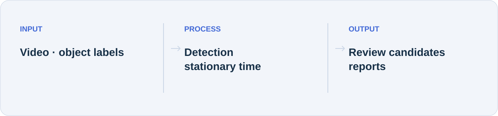
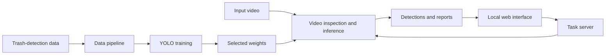

<a name="-illegal-dumping-detection-project"></a>
<!-- readme-header32:start -->
<a name="illegal-dumping-detection-project"></a>
<p align="center"></p>
<h1 align="center" id="project-title">Illegal Dumping Detection Project</h1>
<p align="center">Finding video events for human review</p>
<p align="center">
  <a href="../README.md"></a>
  <a href="README.md"></a>
</p>
<p align="center">
  <a href="../docs/읽기안내/레벨1.md"></a>
  <a href="../docs/읽기안내/레벨2.md"></a>
  <a href="../docs/읽기안내/레벨3.md"></a>
  <a href="../docs/읽기안내/레벨4.md"></a>
  <a href="../docs/읽기안내/레벨5.md"></a>
</p>
<p align="center"><small>LEVEL links open the Korean source at the same reading level.</small></p>
<picture>
  <source media="(max-width: 600px) and (prefers-color-scheme: dark)" srcset="../assets/readme/flow-en-dark-mobile.svg" />
  <source media="(max-width: 600px)" srcset="../assets/readme/flow-en-light-mobile.svg" />
  <source media="(prefers-color-scheme: dark)" srcset="../assets/readme/flow-en-dark.svg" />
  <source media="(prefers-color-scheme: light)" srcset="../assets/readme/flow-en-light.svg" />
  
</picture>
<!-- readme-header32:end -->


This project identifies suspected dumping events by analyzing how long objects remain stationary and when nearby people leave.

<!-- project-levels:start -->
## Choose a reading level

| Level | What this guide covers |
| --- | --- |
| [LEVEL 1 - Beginner (Korean source)](../docs/읽기안내/레벨1.md) | Unfamiliar terms, actual behavior, examples, and common misunderstandings. |
| [LEVEL 2 - Explorer (Korean source)](../docs/읽기안내/레벨2.md) | Connections between inputs, processing, outputs, features, and revision changes. |
| [LEVEL 3 - Practitioner (Korean source)](../docs/읽기안내/레벨3.md) | Prerequisites, usage steps, settings, results, and failure checks. |
| [LEVEL 4 - Advanced (Korean source)](../docs/읽기안내/레벨4.md) | Module design, state transitions, validation boundaries, and implementation choices. |
| [LEVEL 5 - Expert (Korean source)](../docs/읽기안내/레벨5.md) | Actual code, protocols, settings, full comparisons, and measurement evidence. |

Every guide covers the same project and all revisions. The existing detailed content is preserved below.
<!-- project-levels:end -->


**Technical field:** Computer vision › Object detection and tracking › Event candidates based on stationary objects and nearby people

`Python`
`YOLO`
`OpenCV`
`Docker`

[Quick start](#quick-start) · [Repository structure](#repository-structure) · [Data](#data-settings)

[Core components](#input-processing-output)

<a name="implementation-details"></a>

<a name="-데이터학습화면복구보고서를-나눈-구성"></a>
## Separating data, training, interface, recovery, and reporting

Initial Revisions 1 and 2 are notebooks for data preparation and detection experiments.

Final/Revision 3 separates data, training, and inference into `data_pipeline.py`, `train_round3.py`, and `inference.py`, connecting the interface through `backend.py` and `launcher.py`.

Final/Revision 4 provides a single-frame inspection tool for the existing ensemble; Final/Final provides HTML/CSV performance reports.

These are different types of materials and do not share one training procedure.

Revision 7 connects provenance, preparation, and candidate training through `prepare_dataset.py`, `train_pipeline.py`, and `worker.py`. training.json sets seed 20261030, 6 hours per candidate, 18,000MiB free GPU memory, a 7,200-second wait, and 8GiB checkpoint-space reserve. diverse_coco26l uses image size 960·batch4·60epoch·patience12·lr0 =0.0005; small_l_p2 uses 1280·batch2·45epoch·patience12·lr0 =0.0001.

These are plans, not actual completed-epoch counts.

Validation selection orders TACO candidates by min(precision,recall) and F1, then PlastOPol candidates by min(precision,recall) and AP50; ties retain the baseline model. It considers full/full_grid3 policies with evaluation image size 1280·confidence floor0.001·NMS IoU0.5·up to 1000 detections.

Both the download-space requirement and minimum free-space requirement are 100GiB.

Read provenance and splits for the existing evaluation and independent external evaluation together.

The Revision 8 and 10 interfaces read Revision 7 task status to display the current stage, waiting, errors, and retries. Revision 9 records resuming reception after a status-file replacement permission error; Revision 11 is a recovery tool checking the original 16 frozen Revision 7 files. Revision 12 checks experiment termination, results, and weight hashes, then uses report_core, report_outputs, and watcher to generate Word/PDF reports.

Running an interface or recovery tool does not establish completed training.

Under the Revision 3 final report's fixed-test conditions of 150 images·conf0.17·IoU0.50·ensemble/full, results were precision 61.36%·recall 65.83%·F1 63.52%·mAP50 67.31%·mAP50–95 45.70%.

These differ from the 90% target. Object-detection metrics are not CCTV dumping-behavior classification accuracy. A single-frame illustration likewise is neither a behavior judgment nor a recalculation of test metrics.

[Code, conditions, observations, and full comparisons for every revision (Korean source)](../docs/REVISION_INDEX.md)


<a name="️-차수별-개발-흐름"></a>
## Development across revisions

[**Browse Revisions 1–14 and the final version →** (Korean source)](../docs/REVISION_INDEX.md)

## Public revisions and comparisons

Comparisons use actual bytes with each public subfolder aligned by relative path. Differences between materials serving different purposes do not establish performance changes.

Potentially sensitive data and execution-status materials are represented by size/hash rather than copied into patches. Revision 6 preserves selected pre-change files, not all of Revision 5. The Revision 7 comparison uses the baseline commit identified in its documentation below.

| Revision or material | Materials |
| --- | --- |
| Revision 1 | Folder/original: [Material folder](../1%EC%B0%A8)<br>Description: [Details (Korean source)](../docs/versions/stage-1.md)<br>Previous comparison/scope: [Full comparison and scope (Korean source)](../docs/comparisons/initial.md) |
| Revision 2 | Folder/original: [Material folder](../2%EC%B0%A8)<br>Description: [Details (Korean source)](../docs/versions/stage-2.md)<br>Previous comparison/scope: [Full comparison and scope (Korean source)](../docs/comparisons/1-to-2.md) |
| Final/Revision 3 | Folder/original: [Material folder](../%EC%B5%9C%EC%A2%85/3%EC%B0%A8)<br>Description: [Details (Korean source)](../docs/versions/stage-3.md)<br>Previous comparison/scope: [Full comparison and scope (Korean source)](../docs/comparisons/2-to-3.md) |
| Final/Revision 4 | Folder/original: [Material folder](../%EC%B5%9C%EC%A2%85/4%EC%B0%A8)<br>Description: [Details (Korean source)](../docs/versions/stage-4.md)<br>Previous comparison/scope: [Full comparison and scope (Korean source)](../docs/comparisons/3-to-4.md) |
| Final/Final | Folder/original: [Material folder](../%EC%B5%9C%EC%A2%85/%EC%B5%9C%EC%A2%85)<br>Description: [Details (Korean source)](../docs/versions/stage-5.md)<br>Previous comparison/scope: [Full comparison and scope (Korean source)](../docs/comparisons/4-to-final.md) |
| Revision 5 | Folder/original: [Material folder](../5%EC%B0%A8)<br>Description: [Details (Korean source)](../docs/versions/round-5.md)<br>Previous comparison/scope: [Full comparison and scope (Korean source)](../docs/comparisons/final-to-5.md) |
| Revision 6 | Folder/original: [Material folder](../6%EC%B0%A8/%EB%B3%80%EA%B2%BD%EC%A0%84_5%EC%B0%A8)<br>Description: [Details (Korean source)](../docs/versions/round-6.md)<br>Previous comparison/scope: [Full comparison and scope (Korean source)](../docs/comparisons/5-to-6-snapshot.md) |
| Revision 7 | Folder/original: [Material folder](../7%EC%B0%A8)<br>Description: [Details (Korean source)](../docs/versions/round-7.md)<br>Previous comparison/scope: [Full comparison and scope (Korean source)](../docs/comparisons/5-to-7.md) |
| Revision 8 | Folder/original: [Material folder](../8%EC%B0%A8)<br>Description: [Details (Korean source)](../docs/versions/round-8.md)<br>Previous comparison/scope: [Full comparison and scope (Korean source)](../docs/comparisons/7-to-8.md) |
| Revision 9 | Folder/original: [Material folder](../9%EC%B0%A8)<br>Description: [Details (Korean source)](../docs/versions/round-9.md)<br>Previous comparison/scope: [Full comparison and scope (Korean source)](../docs/comparisons/8-to-9.md) |
| Revision 10 | Folder/original: [Material folder](../10%EC%B0%A8)<br>Description: [Details (Korean source)](../docs/versions/round-10.md)<br>Previous comparison/scope: [Full comparison and scope (Korean source)](../docs/comparisons/9-to-10.md) |
| Revision 11 | Folder/original: [Material folder](../11%EC%B0%A8)<br>Description: [Details (Korean source)](../docs/versions/round-11.md)<br>Previous comparison/scope: [Full comparison and scope (Korean source)](../docs/comparisons/10-to-11.md) |
| Previous Docker experiment | Folder/original: [Material folder](../%EC%9D%B4%EC%A0%84%20%EB%8F%84%EC%BB%A4%20%EC%8B%A4%ED%97%98)<br>Description: [Details (Korean source)](../docs/versions/docker-experiment.md)<br>Previous comparison/scope: [Full comparison and scope (Korean source)](../docs/comparisons/docker-to-3.md) |
| Final | Folder/original: [Material folder](../%EC%B5%9C%EC%A2%85)<br>Description: [Details (Korean source)](../docs/versions/final-container.md)<br>Previous comparison/scope: [Full comparison and scope (Korean source)](../docs/comparisons/final-container.md) |
| Revision 12 | Folder/original: [Material folder](../12%EC%B0%A8)<br>Description: [Details (Korean source)](../docs/versions/round-12.md)<br>Previous comparison/scope: [Full comparison and scope (Korean source)](../docs/comparisons/11-to-12.md) |
| Revision 13 | **Original-ID recovery and effective contracts** · [Material folder](../13차) · [Details (Korean source)](../docs/versions/round-13.md) · [Full previous comparison (Korean source)](../docs/comparisons/12-to-13.md) |
| Revision 14 | **DMF document-integrity application** · [Material folder](../14차) · [Details (Korean source)](../docs/versions/round-14.md) · [Full previous comparison (Korean source)](../docs/comparisons/13-to-14.md) |


<a name="️-현재-실험을-보여-주는-10차-대시보드"></a>
## Revision 10 dashboard showing the actual experiment

Three-dimensional models and stage-specific movement show actual download, data-preparation, GPU-training, validation, and final-evaluation status. Video detection, performance analysis, and task records are available in the same interface. Current-file progress is distinguished from overall-experiment progress, and observed values from unmeasured final results.

[Revision 10 execution and interface (Korean source)](../10차/README.md) · [Interface-validation scope (Korean source)](../10차/design-qa.md) · [Public change record (Korean source)](../10차/변경기록.md) · [Full comparison with Revision 9 (Korean source)](../docs/comparisons/9-to-10.md) · [Full comparison with the Revision 8 interface (Korean source)](../docs/comparisons/8-to-10.md)

These interface changes do not establish completed training or achievement of 90% precision and 90% recall. Example dates and values in the mockup are not used as actual experiment results.

<a name="overview"></a>

<a name="‍-제가-구현한-부분"></a>
## My implementation

I wrote code for trash-object dataset preparation, training/evaluation, video inference, and organizing experimental results. Revision-specific code and metrics are linked so that my contributions can be inspected.

<a name="-주요-개발-내용"></a>
## Main development work

The preserved Revision 3 final performance report includes the fixed test and limitations of CCTV interpretation.

These are results recorded in the experiment report.

- The saved HTML reports results on the fixed 150-image test for the selected ensemble/policy. Related CSV files and figures are preserved outputs.
- Check both the missed precision/recall targets and the absence of calculated CCTV accuracy where behavior ground truth is unavailable.

**Materials:** [Final (Korean source)](../docs/versions/final-container.md) · [Revision 1 (Korean source)](../docs/versions/stage-1.md) · [Revision 2 (Korean source)](../docs/versions/stage-2.md) · [Final/Revision 3 (Korean source)](../docs/versions/stage-3.md) · [Final/Revision 4 (Korean source)](../docs/versions/stage-4.md) · [Final/Final (Korean source)](../docs/versions/stage-5.md) · [Complete history (Korean source)](../docs/VERSIONS.md)

<a name="preview"></a>

<a name="input-processing-output"></a>

<a name="-입력처리출력"></a>
## Input, processing, and output

| Stage | What this project covers |
| --- | --- |
| Input | Trash-labeled images and videos to inspect |
| Processing | YOLO detection, IoU association, and stationary-time/person-departure conditions |
| Output | Review candidates, result videos, CSV files, and reports |


---

<a name="introduction"></a>

<a name="-프로젝트-소개"></a>
## Project overview

The project finds potential trash objects in video and organizes scenes for human review.

It covers data preparation, training, and inference for detecting trash in environmental video. Initial notebooks and later experiment code are preserved. CleanView provides video upload, preview, task status, and result-inspection workflows.

| Feature | Implementation |
| --- | --- |
| Data preparation | Collect/convert trash-detection datasets and organize training inputs |
| Model training | YOLO-based training and experiment-result organization |
| Video detection | Read input-video frames and run model inference |
| Local interface | Video upload, preview, task start, status, and logs |
| Task management | Per-task status JSON/logs and restrictions on concurrent starts |
| Result organization | Result saving and report-generation code |



<a name="repository-structure"></a>

<a name="-저장소-구성"></a>
## Repository structure

Experiment entry points and main modules:

```text
.
├── 1차/illegal_dumping_trash_all_new_datasets.ipynb
├── 2차/illegal_dumping_detector.ipynb
├── 이전 도커 실험/
├── 최종/
│   └── 3차/
│       ├── 데이터/taco/
│       └── 클린뷰/
│           ├── data_pipeline.py
│           ├── train_round3.py
│           ├── detector.py
│           ├── inference.py
│           ├── backend.py
│           ├── launcher.py
│           ├── make_report.py
│           └── requirements-docker.txt
├── docs/VERSIONS.md
└── CHANGELOG.md
```

- [Revision 2 research notebook](../2차/illegal_dumping_detector.ipynb): Notebook entry point for dumping-detection experiments.
- [Data preparation](../최종/3차/클린뷰/data_pipeline.py) and [training code](../최종/3차/클린뷰/train_round3.py).
- [Video-frame processing/result saving](../최종/3차/클린뷰/detector.py), [shared prediction/fixed-image evaluation](../최종/3차/클린뷰/inference.py), [task server](../최종/3차/클린뷰/backend.py), and [local launcher](../최종/3차/클린뷰/launcher.py).
- [Dependencies](../최종/3차/클린뷰/requirements-docker.txt) and [version history (Korean source)](../docs/VERSIONS.md).

<a name="implementation"></a>

<a name="-주요-기술과-실행-구조"></a>
## Main technologies and execution structure

Ultralytics detects objects and OpenCV processes frames. The task server uses Linux file locks and process status; the local launcher communicates with task code inside Docker.

The `TRASH_BASE` default in `backend.py` is `/root/환경 PBL`. Status/upload/result paths are under `trash_round3/app`. The local launcher assumes the existing `2026-2` container, so other environments require checking the container name, mounts, and remote paths together.

Task status and selected models are file-managed. After checking video extensions and allowed folders, the system checks the first frame, FPS, file size, and other properties. Inference begins after file copying completes.

<a name="-데이터-분리와-모델-선택"></a>
### Data separation and model selection

`data_pipeline.py` preserves existing image identities and labels and checks SHA-256 values of original validation/test images.

It collects additional TACO images and pLitterStreet inputs, excluding existing URLs and near-duplicates with pHash distance at most 6.

Small-object enlargement images are generated from training images only.

The existence of download code is distinct from permission to redistribute the actual data.

**Stage:** Candidate training

**Final Revision 3 code setting:** YOLO26x·YOLO26l-P2, 180 epochs each for mix → 60 epochs each for focus

**Stage:** Input and optimization

**Final Revision 3 code setting:** 1536 pixels, batch 2, AdamW, seed 20261013; retry at batch 1 on insufficient GPU memory

**Stage:** Fixed evaluation

**Final Revision 3 code setting:** 150 validation images·150 test images; check the exact counts at evaluation

**Stage:** Inference candidates

**Final Revision 3 code setting:** Full image, full+2×2 tiles, full+3×3 tiles; duplicate-box NMS IoU 0.5

**Stage:** Selection

**Final Revision 3 code setting:** Order by validation min(precision, recall), F1, then mAP50

**Stage:** Final test

**Final Revision 3 code setting:** Fix the selected model, policy, and confidence before evaluation; no retraining after testing

**Stage:** Target check

**Final Revision 3 code setting:** Check whether precision and recall are each at least 0.90 at IoU 0.50


These are experiment settings and decision criteria. Earlier revisions use reduced inputs; later evaluation uses original resolution.

<a name="-영상에서-의심-장면을-만드는-조건"></a>
### Conditions for suspected scenes in video

`detector.Events` associates trash boxes at IoU above 0.25 and restarts the stationary timer if IoU with the stationary reference box falls below 0.55.

Under the default settings, an existing object is excluded if observed at least 3 times within the first 10 seconds and stationary at the reference position for at least 2 seconds. A new object becomes a candidate after remaining stationary for at least 20 seconds, with at least 5 seconds since the last sighting of a person previously seen nearby.

At least 3 observations and a one-time-only notification condition also apply.

The method uses image-plane distance between a person's feet and the object's center. It does not recognize ownership or the dumping action itself.

ROI is a polygon with 0~1 coordinates. Outputs are `result.mp4`, per-frame `frames.csv`, and event/settings `summary.json`. `new_candidates` in `frames.csv` is the cumulative event count up to that point, not the number newly created in that frame.

A mid-video decoding failure is not treated as completion.

<a name="️-실행기와-보조-파일"></a>
### Launcher and helper files

`launcher.py` binds only to 127.0.0.1 and uses a random token per execution. It copies task code into the existing Docker `2026-2` container and limits uploads to 4GB. Even `--self-test` initializes the container and copies files; it is not a simple read-only check.

The root in `data_pipeline.py` is fixed at `/root/환경 PBL/trash_round3`. Changing only `TRASH_BASE` in `backend.py` does not move all project paths. Prepare `fonts/NanumGothic-Bold.ttf`, the fixed-split manifest, data/weights, and selected-model files together.

`build_windows.ps1` uses PyInstaller to bundle the interface, task code, and font. `make_report.py` generates graphs, CSV, and HTML from saved final evaluation. `finalize_round3.py` and `finish_on_exit.py` archive results tied to specific historical task IDs/folders; do not use them as general commands to start new training.

<a name="-초기-실험과-외부-taco-코드"></a>
### Initial experiments and external TACO code

The Revision 1 notebook configures YOLOv8m for 150 epochs·input 960·batch 16 and randomly splits TACO and Amsterdam data 80/10/10 within each source.

This split differs from duplicate-group management in the later code.

Initial video results have no dumping-action ground truth, so scenes meeting stationary/tracking conditions are review candidates.

The initial resume JSON is also not bound to model, video, and settings hashes.

External code under `데이터/taco/` is an MIT-licensed Mask R-CNN implementation from Pedro F. Proença and the Matterport lineage.

It uses TensorFlow 1 and Keras 2. Keep its authorship and performance separate from CleanView's PyTorch/YOLO training code. `detector.py` provides train/test/evaluate (COCO segmentation) commands; three notebooks cover statistics, preprocessing, and anchor/ROI exploration.

TACO `requirements.txt` alone does not satisfy all TensorFlow, Keras, imgaug, scikit-image, SciPy, pycocotools, and h5py dependencies.

The code's minimum-version check does not guarantee TensorFlow 2/Keras 3 compatibility.

The public copy lacks the class-mapping CSV, original images, annotations, and weights, so those external examples cannot be run immediately.

Check the original README and LICENSE together.

<a name="quick-start"></a>

<a name="-빠른-시작"></a>
## Quick start

<a name="-노트북부터-살펴보기"></a>
### Start with the notebook

Open the notebook from the repository root. Check data paths and download settings before executing cells.

```powershell
python -m pip install jupyterlab
python -m jupyter lab "2차/illegal_dumping_detector.ipynb"
```

<a name="️-클린뷰-실행-환경-준비"></a>
### Prepare CleanView's execution environment

1. Prepare a Docker container and GPU environment; check the container and remote paths in `launcher.py`.
2. Prepare data and model weights, and match the container's `TRASH_BASE` and `trash_round3` directory structure.
3. Prepare packages from the [dependency specification](../최종/3차/클린뷰/requirements-docker.txt) inside the container's Python environment. It is written to reuse existing CUDA PyTorch; do not replace it arbitrarily with a CPU package.
4. Confirm required interface assets and selected-model files before starting the local launcher.

```powershell
cd "최종/3차/클린뷰"
python launcher.py --no-browser
```

The launcher records the local address and access token in a session file. This command is an entry point present in code; the public copy does not automatically install Docker, datasets, and models. Original video and training weights must be prepared separately.

<a name="data-settings"></a>

<a name="-데이터-구성과-실험-설정"></a>
## Data and experiment settings

<a name="-보존한-최종-성능-보고서"></a>
### Preserved final performance report

The [Revision 3 final report](../최종/최종/성능보고서/3차_최종보고서.html) and [final-performance CSV](../최종/최종/성능보고서/최종성능.csv) are preserved together. Values below are rounded from the saved CSV under the **fixed 150-image test and validation-selected confidence** conditions.

| Metric | Preserved result |
| --- | --- |
| Precision | 61.36% |
| Recall | 65.83% |
| F1 | 63.52% |
| mAP50 | 67.31% |
| mAP50–95 | 45.70% |

The target of at least 90% precision and 90% recall was not met. The report's 5 graphs, aggregate CSV, existing font, and OFL license are included together. GitHub may display HTML as source; download the report folder and open it in a local browser.


| Component | Role |
| --- | --- |
| TACO-related code | Reference for downloading trash data and processing detection data |
| Notebook input data | Detection datasets specified in individual experiment cells |
| Model weights | Training outputs or a detection model prepared by the user |
| Video input | `.mp4`, `.avi`, `.mov`, `.mkv`, `.m4v` |
| Task status | Per-task JSON, execution logs, and selected-model information |
| Results | Detection-result videos/files and generated reports |

Check each dataset's download path and usage conditions. Included download tools do not mean the entire dataset is distributed through this repository.

Object detection and tracking find trash-candidate scenes for human review. Behavioral intent and legal violations require separate confirmation. Performance comparisons use the same data splits, models, and inference conditions.

<a name="troubleshooting"></a>

<a name="️-문제-해결"></a>
## Troubleshooting

| Symptom | What to check |
| --- | --- |
| Docker/container error | Whether Docker is running, and container name/paths in `launcher.py` |
| Model not found | Weight-file location and selected-model information |
| Video preview fails | Completed copying, zero-byte files, codec, first frame, and FPS |
| New task will not start | Running tasks and their status/logs |
| Linux file-lock error | Whether `backend.py` is running in a Linux container |
| Local interface access error | The current session URL and token generated by the launcher |

---

<div align="center">

**Prepare data → Train → Detect in video → Inspect results**

</div>

## 2026-10-30 execution and additional-training materials

[D-drive dashboard and Revision 5 code (Korean source)](../5차/README.md) record execution conditions and post-training error diagnosis. Final performance evaluation must be checked separately.

## Revision 7 training with additional large-scale data

[Revision 7 code and execution conditions (Korean source)](../7차/README.md) describe original preservation, source balancing, split evaluation, and independent tasks. Data reception and automatic preparation started on 2026-10-30; long-running training completion and achievement of 90% are not yet confirmed in this record.


[Full public-file comparisons, including comments, whitespace, documents, and reports → (Korean source)](../docs/FOLDER_COMPARISONS.md)


[Full public-file comparisons, including comments, whitespace, documents, and reports → (Korean source)](../docs/FOLDER_COMPARISONS.md)


<a name="️-11차-수신-복구"></a>
## Revision 11 reception recovery

[Recovery tool (Korean source)](../11차/README.md) · [Public change record (Korean source)](../docs/changes/2026-11-02-11차복구.md) · [Comparison with Revision 10 (Korean source)](../docs/comparisons/10-to-11.md)

**Execution scope:** The original frozen Revision 7 installation environment.

A clone of the public repository alone may fail the 16-original-file baseline check.

The public copy lacks original `docs/구현계획.md` and `docs/설계.md`; `tests/test_worker.py` also differs in bytes between original CRLF and public LF.

The original baseline files are required. Do not bypass this by replacing baseline hashes with new values.

A match for the 16 baseline files in the current local installation is distinct from completeness of a public clone.

<a name="-12차-실험-보고서-도구"></a>
## Revision 12 experiment-report tools

[Report-generation tool (Korean source)](../12차/README.md) · [Public change record (Korean source)](../docs/changes/2026-11-02-12차보고서도구.md) · [Comparison with Revision 11 (Korean source)](../docs/comparisons/11-to-12.md)

This post-processing tool checks frozen results after the specified experiment ends, then creates Word and a PDF of the same manuscript. Actual performance and target achievement are determined from experiment measurements; the published fixed text is not an actual final report.

The existing frozen Revision 7 installation environment is required. The public repository lacks two baseline documents, and one test file has different line-ending bytes, so a standalone clone may not pass the original-hash check. Do not replace baseline hashes with current values to bypass it. Check the fixed dependencies on Revision 10 safe reading/font and Revision 11 recovery code as well.

<a name="-최종-배포-사용안내"></a>
## Final-distribution user guide

The [original user guide](../최종/최종/사용안내.txt) is available alongside the existing final report.

This existing document covers Docker, CleanView execution, and result locations. It is linked with the [document-addition record (Korean source)](../docs/changes/2026-11-02-배포사용안내.md) and [full text comparison for this update](../docs/comparisons/2026-11-02-deployment-guide.patch).

It adds no new product-development revision or experiment result.

## DMF application for the ICT safety course

The actual DMF library checks per-document modification limits, versions, and audit records. This is local validation separate from existing training; no Official promotion is performed. [Revision 14 execution and scope (Korean source)](../14차/README.md) · [Full comparison with the previous revision (Korean source)](../docs/comparisons/13-to-14.md)

[ICT Safety Project DMF application report PDF](../14차/보고서/ICT%20안전%20프로젝트%20DMF%20적용%20보고서.pdf) · [Editable Word](../14차/보고서/ICT%20안전%20프로젝트%20DMF%20적용%20보고서.docx)
